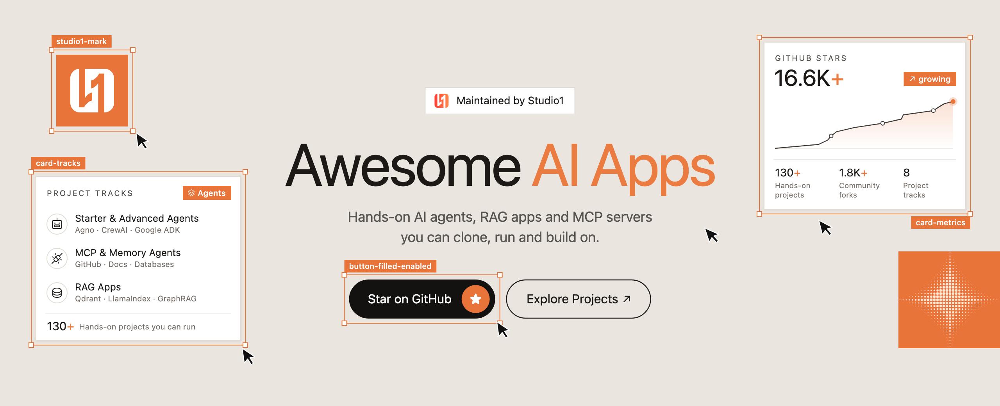
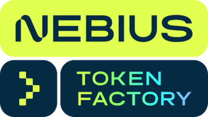
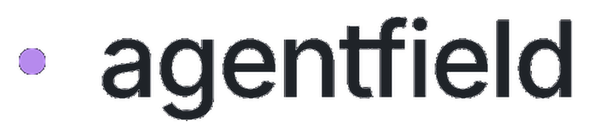

<picture>
  <source media="(prefers-color-scheme: dark)" srcset="assets/awesome_banner_dark.png">
  
</picture>

<div align="center">

# Awesome AI Apps [](https://awesome.re)

**137 runnable LLM apps and agents, from 5-minute framework starters to production-grade multi-agent systems.**

[](https://github.com/Arindam200/awesome-ai-apps/stargazers)
[](https://github.com/Arindam200/awesome-ai-apps/network/members)
[](#-contributors)
[](https://github.com/Arindam200/awesome-ai-apps/commits/main)
[](LICENSE)
[](CONTRIBUTING.md)

<a href="https://trendshift.io/repositories/14662" target="_blank"></a>

[**Browse projects**](#-browse-by-category) · [**Quick start**](#-quick-start) · [**Contribute**](#-contributing) · [**Sponsor**](#-sponsors) · [**Newsletter**](#-stay-updated)

</div>

Awesome AI Apps is a hands-on collection of projects, tutorials and recipes for building LLM-powered applications: text agents, voice assistants, RAG apps, MCP tools and fine-tuning pipelines. Each project lives in its own folder with a README, its own dependencies and a `.env.example`, so you can clone the repo, open one folder and run it.

<div align="center">

## 💎 Sponsors

<p align="center">A huge thank you to the companies supporting Awesome AI Apps.</p>

<table align="center">
  <tr>
    <td align="center" width="33%">
      <a href="https://dub.sh/brightdata" title="Bright Data">
        <picture>
          <source media="(prefers-color-scheme: dark)" srcset="assets/sponsors/brightdata_dark.svg">
          
        </picture>
      </a>
      <br><sub>Web Data Platform</sub>
    </td>
    <td align="center" width="33%">
      <a href="https://dub.sh/nebius" title="Nebius Token Factory">
        
      </a>
      <br><sub>AI Inference Provider</sub>
    </td>
    <td align="center" width="33%">
      <a href="https://dub.sh/scrapegraphai" title="ScrapeGraphAI">
        
      </a>
      <br><sub>ScrapeGraphAI · AI Web Scraping</sub>
    </td>
  </tr>
  <tr>
    <td align="center" width="33%">
      <a href="https://dub.sh/memorilabs" title="Memori">
        <picture>
          <source media="(prefers-color-scheme: dark)" srcset="assets/sponsors/memori_dark.png">
          
        </picture>
      </a>
      <br><sub>SQL Native Memory for AI</sub>
    </td>
    <td align="center" width="33%">
      <a href="https://dub.sh/copilotkit" title="CopilotKit">
        <picture>
          <source media="(prefers-color-scheme: dark)" srcset="assets/sponsors/copilotkit_dark.svg">
          
        </picture>
      </a>
      <br><sub>Agentic Application Platform</sub>
    </td>
    <td align="center" width="33%">
      <a href="https://dub.sh/scalekitt" title="ScaleKit">
        <picture>
          <source media="(prefers-color-scheme: dark)" srcset="assets/sponsors/scalekit_dark.svg">
          
        </picture>
      </a>
      <br><sub>Auth Stack for AI</sub>
    </td>
  </tr>
  <tr>
    <td align="center" width="33%">
      <a href="https://okahu.ai" title="Okahu">
        <picture>
          <source media="(prefers-color-scheme: dark)" srcset="assets/sponsors/okahu_dark.png">
          
        </picture>
      </a>
      <br><sub>AI Observability Platform</sub>
    </td>
    <td align="center" width="33%">
      <a href="https://dub.sh/agentfield" title="AgentField">
        <picture>
          <source media="(prefers-color-scheme: dark)" srcset="assets/sponsors/agentfield_dark.png">
          
        </picture>
      </a>
      <br><sub>Kubernetes for AI Agents</sub>
    </td>
    <td align="center" width="33%">
      <a href="https://dub.sh/byteful" title="Byteful">
        <picture>
          <source media="(prefers-color-scheme: dark)" srcset="assets/sponsors/byteful_dark.png">
          
        </picture>
      </a>
      <br><sub>Residential &amp; ISP Proxies</sub>
    </td>
  </tr>
</table>

<p align="center">
  <b>Want your product in front of developers building with LLMs?</b>
  <br>
  <a href="mailto:contact@studio1hq.com?subject=Sponsoring%20Awesome%20AI%20Apps">Become a sponsor →</a>
</p>

</div>

## 🧭 Browse by Category

| Category | What you'll find | Projects |
| :-- | :-- | :-: |
| [🧩 Starter Agents](#-starter-agents) | One minimal agent per framework: Agno, LangGraph, CrewAI, OpenAI Agents SDK, Google ADK, Mastra and more | 21 |
| [🪶 Simple Agents](#-simple-agents) | Single-purpose agents for everyday tasks: finance, calendars, browser automation, SQL | 20 |
| [🎙️ Voice Agents](#️-voice-agents) | Real-time voice assistants with LiveKit, Pipecat, Gradium and Deepgram | 9 |
| [🗂️ MCP Agents](#️-mcp-agents) | Model Context Protocol servers and agents wired to external tools | 14 |
| [🧠 Memory Agents](#-memory-agents) | Agents that remember users and context across sessions | 13 |
| [📚 RAG Applications](#-rag-applications) | Retrieval, reranking, GraphRAG, OCR and citation checking | 18 |
| [🔬 Advanced Agents](#-advanced-agents) | Multi-agent pipelines and production-shaped end-to-end workflows | 36 |
| [🧬 Fine-Tuning](#-fine-tuning) | LoRA fine-tuning, distillation and deployment of open models | 6 |

**Also here:** [Tutorials & Videos](#-tutorials--videos) · [Quick Start](#-quick-start) · [Contributing](#-contributing) · [Contributors](#-contributors) · [Maintainers](#-maintainers) · [License](#-license)

## 🚀 Featured AI Apps

### 🧩 Starter Agents

**Quick-start agents for learning and extending different AI frameworks.** _21 projects_

- [AutoGen Tool-Calling Starter](starter_ai_agents/autogen_starter): Microsoft AutoGen `AssistantAgent` with a custom tool, powered by Nebius Token Factory
- [AWS Strands Agent Starter](starter_ai_agents/aws_strands_starter): Weather report agent using AWS Strands SDK
- [CAMEL AI Model Benchmark](starter_ai_agents/camel_ai_starter): Performance benchmarking tool comparing various AI models
- [Coding Harness Starter](starter_ai_agents/coding_harness_starter): OpenAI Agents SDK coding loop with plan, approval-gated edits, fixed tests, and bounded review, powered by Nebius Token Factory
- [CrewAI Research Crew](starter_ai_agents/crewai_starter): Multi-agent research team example
- [Docker cagent Multi-Agent Starter](starter_ai_agents/cagent_starter): Open-source customizable multi-agent runtime by Docker
- [DSPy Optimization Starter](starter_ai_agents/dspy_starter): DSPy framework for building and optimizing AI systems
- [Google Agent Development Kit Starter](starter_ai_agents/google_adk_starter): Google Agent Development Kit starter template
- [Hacker News Trend Analyst (Agno)](starter_ai_agents/agno_starter): Agno-based agent for trend analysis on Hacker News
- [Hugging Face smolagents Starter](starter_ai_agents/smolagents_starter): Hugging Face smolagents code-first web-search agent
- [KAOS Kubernetes Multi-Agent Starter](starter_ai_agents/kaos_starter): Kubernetes-native multi-agent system with MCP tools and in-cluster LLM
- [LangChain Tool-Calling Starter](starter_ai_agents/langchain_starter): LangChain tool-calling agent with `create_tool_calling_agent` + `AgentExecutor`, powered by Nebius
- [LangGraph ReAct Agent Starter](starter_ai_agents/langgraph_starter): LangGraph prebuilt ReAct agent (`create_react_agent`) with custom tools, powered by Nebius
- [Letta Stateful Memory Agent](starter_ai_agents/letta_starter): Stateful agent with persistent long-term memory across sessions
- [LlamaIndex Task Manager](starter_ai_agents/llamaindex_starter): LlamaIndex-powered task assistant
- [Mastra Tool-Calling Starter](starter_ai_agents/mastra_starter): TypeScript-first agent with a custom tool powered by Nebius Token Factory
- [Microsoft Agent Framework Starter](starter_ai_agents/microsoft_agents_starter): Multi-agent travel planning demos built on Microsoft Agent Framework
- [OpenAI Agents SDK Starter](starter_ai_agents/openai_agents_sdk): OpenAI Agents SDK with email helper and haiku writer examples
- [PydanticAI Weather Bot](starter_ai_agents/pydantic_starter): Real-time weather information agent
- [Sayna Realtime Voice Agent](starter_ai_agents/sayna_starter): Real-time voice infrastructure with multi-provider STT/TTS (Deepgram, ElevenLabs, Azure, Google) and WebSocket streaming
- [Semantic Kernel Starter](starter_ai_agents/semantic_kernel_starter): Microsoft Semantic Kernel `ChatCompletionAgent` with plugin-based tool calling

### 🪶 Simple Agents

**Straightforward, practical use-cases for everyday AI applications.** _20 projects_

- [Agno Agent Examples](simple_ai_agents/agno_ai_examples): Simple to multi-agent examples with web search and a knowledge base
- [Agno Agent UI](simple_ai_agents/agno_ui_agent): Interactive UI for web and finance agents
- [AI Agent Registry Explorer](simple_ai_agents/agent_discovery_agent): Find and compare AI agents across NANDA, MCP, Virtuals, A2A, and ERC-8004 registries
- [AI Expense Tracker](simple_ai_agents/ai_expense_tracker): Chat-based expense tracking with Nebius Token Factory and a Postgres backend that agents provision on first run
- [Calendar Assistant](simple_ai_agents/cal_scheduling_agent): Calendar scheduling integration with Cal.com
- [Cost-Aware Model Router (RouteLLM)](simple_ai_agents/llm_router): Intelligent model routing with RouteLLM (GPT-4o-mini vs Nebius Llama) for cost optimization
- [Email-to-Calendar Assistant](simple_ai_agents/email_to_calendar_scheduler): AI-powered Gmail reader and Google Calendar manager
- [Financial Reasoning Agent](simple_ai_agents/reasoning_agent): Step-by-step financial reasoning demonstration
- [Human-in-the-Loop Agent](simple_ai_agents/human_in_the_loop_agent): HITL actions for safe AI task execution
- [LangChain Operations Agent Collection](simple_ai_agents/langchain_simple_agents): Nebius-powered incident response, support, vendor risk, and data quality agents with typed outputs and guarded tools
- [Macro Event Brief Agent](simple_ai_agents/macro_event_brief_agent): Scheduled macro releases with last prints, publication times and sources, plus an optional Nebius brief that cites each record
- [Mastra Weather Bot](simple_ai_agents/mastra_ai_weather_agent): Weather updates using Mastra AI framework
- [Natural-Language Database Assistant](simple_ai_agents/talk_to_db): Natural language database queries with GibsonAI and LangChain
- [Natural-Language SQL Agent (LangChain)](simple_ai_agents/langchain_data_agent_poc): Natural-language-to-SQL data agent with LangGraph, Nebius, read-only SQL safety, and Streamlit charts
- [Nebius Chat](simple_ai_agents/nebius_chat): Chat interface for Nebius Token Factory
- [Newsletter Generator](simple_ai_agents/newsletter_agent): AI-powered newsletter builder with Firecrawl integration
- [Stock Market Finance Agent](simple_ai_agents/finance_agent): Real-time stock and market data tracking agent
- [Stock Portfolio Analyst](simple_ai_agents/stock_portfolio_analyst): Live portfolio valuation, concentration analysis, risk flags, and rebalancing ideas with Agno
- [VoyageCompass Travel Planner](simple_ai_agents/nebius_travel_planner): LangChain and Nebius travel planner with weather, research, currency conversion, budgets, and packing tools
- [Web Automation Agent](simple_ai_agents/browser_agent): Browser automation agent using Nebius and browser-use

### 🎙️ Voice Agents

**Real-time voice assistants and streaming speech pipelines**, including LiveKit, Pipecat, Gradium, and [VoxCode](voice_agents/Cursor_code_editor) (Deepgram + Cursor SDK). _9 projects_

- [AI Pitch Coach (Gradium + Nebius)](voice_agents/voice-agent-gradium-nebius-langchain): Conversational pitch coach using Gradium STT/TTS, LangChain orchestration, and Nebius reasoning
- [Customer Support Voice Agent (LiveKit)](voice_agents/customer_support_agent): Nebius-powered voice support agent with context-preserving AI manager handoff, noise cancellation, and inactivity handling
- [Gemini Realtime Voice Agent (LiveKit)](voice_agents/livekit_gemini_agents): LiveKit Agents with Google Gemini Live (`gemini` multimodal realtime) for low-latency voice conversations in a LiveKit room
- [Healthcare Voice Contact Center](voice_agents/healthcare_contact_center): Pipecat healthcare contact center with appointment booking, FAQ handling, and supervisor escalation
- [Multilingual Voice Agent (Pipecat + Sarvam)](voice_agents/pipecat_agent): Pipecat voice pipeline with Sarvam STT/TTS and OpenAI for chat; WebRTC (browser) or Daily transport via the Pipecat runner
- [RSVP Confirmation Voice Agent (LiveKit)](voice_agents/livekit_rsvp_agent): Outbound voice agent that calls attendees, confirms RSVPs, and updates a JSON-backed event database
- [Speed-to-Lead Sales Voice Agent](voice_agents/speed_to_lead_agent): LiveKit-based voice agent that calls inbound leads instantly, routes them to specialists, and logs to a mock CRM
- [VoxCode: Deepgram + Cursor Voice Coding Agent](voice_agents/Cursor_code_editor): Local voice workspace for codebase summaries and architecture Q&A; Deepgram Voice Agent orchestration, Nebius reasoning, and optional Cursor SDK file inspection and edits
- [Web-Search Voice Agent (LiveKit)](voice_agents/livekit_web_search_agent): LiveKit + Gemini realtime voice agent with an Olostep-backed `web_search` tool for fresh, source-cited answers

### 🗂️ MCP Agents

**Examples using Model Context Protocol for external tool integration.** _14 projects_

- [Couchbase LangGraph MCP Agent](mcp_ai_agents/langchain_langgraph_mcp_agent): LangChain ReAct agent with Couchbase integration
- [Couchbase MCP Server](mcp_ai_agents/couchbase_mcp_server): Couchbase database integration with MCP protocol
- [Custom MCP Server Starter](mcp_ai_agents/custom_mcp_server): Custom MCP server implementation example
- [Documentation Q&A MCP Agent](mcp_ai_agents/docs_qna_agent): Documentation Q&A agent with MCP
- [Documentation RAG MCP Server](mcp_ai_agents/doc_mcp): Semantic RAG documentation and Q&A system
- [GibsonAI Database MCP Agent](mcp_ai_agents/database_mcp_agent): Conversational AI agent for managing GibsonAI database projects and schemas
- [GitHub MCP Agent](mcp_ai_agents/github_mcp_agent): Repository insights and analysis via MCP
- [GitHub MCP Agent Starter](mcp_ai_agents/mcp_starter): GitHub repository analyzer starter template
- [Hotel Finder Agent](mcp_ai_agents/hotel_finder_agent): Hotel search and booking using MCP integration
- [Sandboxed Code Execution MCP Agent (Docker + E2B)](mcp_ai_agents/e2b_docker_mcp_agent): Secure AI agent for running agents in sandboxed Docker environments via MCP Gateway
- [Secure Database MCP Agent (MCP Toolbox)](mcp_ai_agents/mcp_toolbox_security_agent): Secure ecommerce agent over PostgreSQL and MongoDB; MCP Toolbox enforces per-user data access, least-privilege roles, and authorized tools
- [Secure MCP Access Agent (ScaleKit + Exa)](mcp_ai_agents/scalekit-exa-mcp-security): Security-focused MCP integration with Exa search
- [Self-Healing Text-to-SQL Agent (Okahu)](mcp_ai_agents/telemetry-mcp-okahu): Self-healing Text-to-SQL demo using Okahu Cloud traces via hosted MCP
- [Taskade MCP Agent](mcp_ai_agents/taskade_mcp_agent): AI-powered workspace agent for managing projects, tasks, and workflows via Taskade MCP

### 🧠 Memory Agents

**Agents with advanced memory capabilities for context retention and personalization.** _13 projects_

- [AI Research Consultant with Long-Term Memory](memory_agents/ai_consultant_agent/): AI-powered consulting agent using **Memori v3** as a long-term memory fabric and **ExaAI** for research
- [arXiv Researcher Agent with Memori](memory_agents/arxiv_researcher_agent_with_memori): Research assistant using OpenAI Agents and GibsonAI Memori
- [AWS Strands Persistent Memory Agent](memory_agents/aws_strands_agent_with_memori): AWS Strands agent enhanced with the Memori memory system
- [Blog Writing Agent](memory_agents/blog_writing_agent): Personalized blog writing agent with memory for style consistency
- [Brand Reputation Monitor](memory_agents/brand_reputation_monitor): AI-powered brand reputation monitoring with news analysis and sentiment tracking
- [Customer Support Voice Agent](memory_agents/customer_support_voice_agent): Voice-enabled customer support assistant with Memori v3 and Firecrawl for knowledge base management
- [Engineering Content Agent](memory_agents/engineering_content_agent): Chat-first Agno app that turns HN demand, DEV.to supply gaps, and Weaviate Engram memory into a developer trend digest plus DevRel talk and blog ideation via Nebius
- [Job Search Agent](memory_agents/job_search_agent): Job search agent with memory for preference tracking
- [Persistent Memory Agent (Agno)](memory_agents/agno_memory_agent): Agno-based agent with persistent memory capabilities
- [Product Launch Agent](memory_agents/product_launch_agent): Competitive intelligence tool for analyzing competitor product launches
- [Social Media Agent](memory_agents/social_media_agent): Social media automation agent with memory for brand voice
- [Study Coach Agent](memory_agents/study_coach_agent): AI-powered study coach with Memori v3 and LangGraph for multi-step verification of understanding
- [YouTube Trend Agent](memory_agents/youtube_trend_agent): YouTube channel analysis agent with Memori, Agno, and Exa for trend analysis and video ideas

### 📚 RAG Applications

**Retrieval-augmented generation examples for document understanding and knowledge bases.** _18 projects_

- [Agentic RAG with Agno and GPT-5](rag_apps/agentic_rag): Agentic RAG implementation with Agno and GPT-5
- [Agentic Typed RAG with LlamaIndex](rag_apps/agentic_typed_rag_llamaindex): Typed, citation-verified RAG with structured answers, local document parsing, and deterministic refusal for weak evidence
- [Codebase Q&A RAG](rag_apps/chat_with_code): Conversational code explorer and documentation assistant
- [Enterprise Contextual RAG](rag_apps/contextual_ai_rag): Enterprise-level RAG with managed datastores and quality evaluation
- [Gemma 3 Document OCR](rag_apps/gemma_ocr/): OCR-based document and image processor using the Gemma 3 model
- [GraphRAG with Neo4j](rag_apps/graphrag_neo4j): Knowledge graph extraction and Cypher-backed retrieval with Neo4j and Nebius
- [LiteParse Invoice & Receipt Auditor](rag_apps/liteparse_invoice_auditor): Local OCR with LiteParse bounding boxes, Nebius LLM audit for math errors and duplicate charges, evidence pinning on scans, and an LLM batch summary
- [LlamaIndex RAG Starter](rag_apps/llamaIndex_starter): LlamaIndex and Nebius RAG starter template
- [LLM and RAG Debugger (WFGY 16-Problem Map)](rag_apps/wfgy_llm_debugger): 16-mode map-based debugger for LLM and RAG bugs
- [Multi-PDF RAG Analyzer](rag_apps/pdf_rag_analyser): Multi-PDF chat and analysis system
- [Nebius RAG Starter](rag_apps/simple_rag): Basic RAG implementation with Nebius for quick starts
- [NVIDIA Nemotron Document OCR](rag_apps/nvidia_ocr/): OCR-based document and image parsing using NVIDIA Nemotron-Nano-V2-12b
- [Production PDF RAG with Reranking](rag_apps/advanced_rag_with_reranking): Production-shaped PDF RAG with contextual retrieval, Qdrant hybrid search, reranking, streaming answers, upload ingestion, and clickable citations
- [Qwen3 PDF RAG Chat](rag_apps/qwen3_rag): PDF chatbot interface built with Streamlit
- [Resume Optimizer](rag_apps/resume_optimizer): AI-powered resume optimization and enhancement tool
- [Trustworthy RAG](rag_apps/trustworthy_rag): Citation verification, per-claim evidence checks, and hallucination scoring for RAG answers
- [Video Q&A with Timestamp Citations](rag_apps/video_rag): Multimodal video retrieval with Gemini embeddings, Weaviate, Nebius, and clickable timestamp citations
- [Web-Augmented Agentic RAG](rag_apps/agentic_rag_with_web_search): Advanced RAG with CrewAI, Qdrant, and Exa for hybrid search capabilities

### 🔬 Advanced Agents

**Complex multi-agent pipelines for production-ready end-to-end workflows.** _36 projects_

- [AI Hedge Fund Research Team](advance_ai_agents/ai-hedgefund): Agentic workflow for comprehensive financial analysis
- [AI Trend Research Agent](advance_ai_agents/trend_analyzer_agent): AI trend mining and analysis with Google ADK
- [Candidate Profile Analyzer (Candilyzer)](advance_ai_agents/candidate_analyser): Candidate analysis tool for GitHub and LinkedIn profiles
- [Car Finder Agent](advance_ai_agents/car_finder_agent): AI-powered used car recommendation system with CrewAI and MongoDB
- [Clinical Early-Warning Agent](advance_ai_agents/clinical_early_warning_agent): Nebius Token Factory tool-calling agent that spots patient deterioration with NEWS2, qSOFA, personal baselines and trends
- [Conference Proposal Generator](advance_ai_agents/conference_agnositc_cfp_generator): Automated conference proposal generation system
- [Conference Talk Abstract Generator](advance_ai_agents/conference_talk_abstract_generator): Automated talk abstract generation with Google ADK and Couchbase
- [Contract Review Crew (Paralegal)](advance_ai_agents/paralegal_crew): CrewAI contract review workflow for clause extraction, risk analysis, and recommended redlines
- [Cosmos Arena Debate Council](advance_ai_agents/cosmos_arena_debate_council): Multi-agent debate council built with LangGraph and the NVIDIA Cosmos reasoning model via Nebius Token Factory
- [Customer Support Resolution Agent](advance_ai_agents/customer_support_resolution_agent): LangChain and Nebius support agent with knowledge-base retrieval, order lookup, and human ticket escalation
- [Deep Research + Writing Agents Workshop](advance_ai_agents/deep_research_writing_agents_nebius_okahu): Nebius-powered LangChain MCP workshop with Exa research, Gemini image generation, and Okahu/Monocle eval observability
- [Deep Research Workflow](advance_ai_agents/deep_researcher_agent): Multi-stage research agent with Agno and ScrapeGraph AI
- [Due Diligence Agent](advance_ai_agents/due_diligence_agent): Multi-agent company due diligence pipeline with AG2 and TinyFish deep web scraping
- [Financial Document OS](advance_ai_agents/financial_document_os): Turns financial PDFs into an editable relational database with source-level citations
- [Financial Market Data Service](advance_ai_agents/finance_service_agent): FastAPI server for stock data and predictions with Agno
- [Financial Research Agent (AgentField)](advance_ai_agents/agentfield_finance_research_agent): Financial research agent with AgentField
- [GitHub and LinkedIn Job Finder](advance_ai_agents/job_finder_agent): LinkedIn job search automation with Bright Data integration
- [Jev Social Research Agent](advance_ai_agents/jev_social_research_agent): Typed Jev routing, local socai CLI evidence, and evidence-linked Nebius synthesis for Instagram, TikTok, and LinkedIn research
- [Local File-Editing Agent Prototype](advance_ai_agents/coding_harness_agent): Local coding-agent prototype with file discovery, reading, and editing tools
- [Maintainer Intelligence Brief](advance_ai_agents/maintainer_brief): Weekly open-source intelligence briefs from community, security, and document signals with source citations
- [Meeting Assistant Agent](advance_ai_agents/meeting_assistant_agent): Automated meeting notes and task creation from conversations
- [Multi-Agent Coding Harness](advance_ai_agents/coding_agent_harness): Deep LangGraph coding crew with planning, repository exploration, human-gated file edits, and E2B-sandboxed test loops
- [Nebius Autonomous Pipeline Optimizer](advance_ai_agents/nebius-autoresearch-autoresearch-mar30): NYC taxi analytics pipeline optimizer with iterative code search using real-time or batch Nebius Token Factory inference
- [Pre-Meeting Intel Agent (Briefing Room)](advance_ai_agents/meeting_briefing_agent): LangGraph plan-research-reflect loop with Tavily web search that turns a company name into a cited one-page meeting brief
- [Price Monitoring Agent](advance_ai_agents/price_monitoring_agent): Price monitoring and alerting agent powered by CrewAI, Twilio, and Nebius
- [Prompt Format Benchmark](advance_ai_agents/context_engineering_pipeline): Benchmark harness for comparing XML, JSON, and Markdown prompt formats across accuracy, latency, and token usage
- [Sandboxed Browser Game Generator](advance_ai_agents/pydantic_game_agent): FastAPI multi-agent studio that generates sandboxed browser games from one prompt using Pydantic AI and GLM-5.2 on Nebius
- [SEO Content Strategy Team](advance_ai_agents/content_team_agent): SEO content optimization workflow with Agno and SerpAPI for Google AI Search ranking
- [Shark Tank Pitch Practice Agent](advance_ai_agents/shark_tank_agent): Interactive 3D Shark Tank room with three Nebius-backed Mastra investor sharks, round-based Q&A, deal memos, and SQLite report history
- [Software Engineering Model Arena](advance_ai_agents/coding_model_arena): [Nebius Token Factory](https://dub.sh/nebius) benchmark for two coding models with seven curated challenges, weighted local hidden tests, partial-credit scoring, and an independent judge
- [Startup Go-to-Market Strategy Agent](advance_ai_agents/smart_gtm_agent): Go-to-market strategy and competitive analysis agent
- [Startup Idea Validator Agent](advance_ai_agents/startup_idea_validator_agent): Agentic workflow to validate and analyze startup ideas
- [Temporal Agents](advance_ai_agents/temporal_agents/): Examples of Temporal-based AI agents
- [Temporal Transaction Agent Evaluation (Okahu + Monocle)](advance_ai_agents/temporal_agents/temporal_okahu_agent/temporal-tx-agent-eval): Evaluation and regression loop for a Temporal fraud-processing agent, using OpenTelemetry traces, deterministic checks, and LLM-graded Okahu evaluations
- [Web Intelligence Agent](advance_ai_agents/web_intelligence_agent): Mastra multi-agent pipeline that turns Olostep web evidence into Nemotron-verified case studies with SQLite persistence and a Velt audit trail
- [Workflow Audit Trail (FlowSentinel)](advance_ai_agents/flowsentinal_audittrail): Next.js workflow command center with Nebius Nemotron reasoning, n8n orchestration, Velt activity logs, and optional Tailscale Funnel exposure

### 🧬 Fine-Tuning

**End-to-end examples of fine-tuning open-source LLMs, from data prep to deployment.** _6 projects_

- [Customer Support Fine-Tuning with Data Lab](fine_tuning/customer_support_datalab): Teacher-student distillation workflow to generate support data, curate it in Data Lab, fine-tune, and deploy
- [Insurance Claims Fine-Tuning](fine_tuning/insurance_claims_finetuning): Data Lab, LoRA fine-tuning, and a Gradio comparison app for insurance claims
- [Legal Tech Fine-Tuning (Self-Hosted)](fine_tuning/legal-tech-fine-tuning-nebius-cloud): Fine-tunes Gemma on UK legislation with LoRA, serves with vLLM, and exposes a FastAPI layer
- [Legal Tech Fine-Tuning (Token Factory)](fine_tuning/legal-tech-fine-tuning-token-factory): Managed LoRA fine-tuning on Nebius Token Factory with private model deployment
- [Open-Source LLM Fine-Tuning on Token Factory](fine_tuning/open_source_llms_token_factory): Colab-first LoRA fine-tuning walkthrough to upload a dataset, train, monitor, and deploy
- [Standalone Customer Support Fine-Tuning (Colab)](fine_tuning/customer_support_standalone_colab): Fully standalone Colab notebook for the customer-support distillation and fine-tuning flow

## 📺 Tutorials & Videos

### 🎓 Course Playlists

- [**AWS Strands Course**](course/aws_strands): Complete 8-lesson course on building AI agents with AWS Strands SDK ([watch the playlist](https://www.youtube.com/playlist?list=PLMZM1DAlf0Lrc43ZtUXAwYu9DhnqxzRKZ))
- [**Voice Agents Playlist**](https://www.youtube.com/watch?v=c6t4q0tE61E&list=PLKCdxubW1354): Tutorials on building voice agents

### 🔧 Framework Tutorials

- [**AI Agents, MCP and more...**](https://www.youtube.com/playlist?list=PL2ambAOfYA6-LDz0KpVKu9vJKAqhv0KKI): Mixed tutorials and project demos
- [**Build AI Agents**](https://www.youtube.com/playlist?list=PLMZM1DAlf0LqixhAG9BDk4O_FjqnaogK8): General AI agent development tutorials
- [**Build with MCP**](https://www.youtube.com/playlist?list=PLMZM1DAlf0Lolxax4L2HS54Me8gn1gkz4): Model Context Protocol tutorials and examples

## ⚡ Quick Start

You need **Python 3.10+**, **[uv](https://docs.astral.sh/uv/)** or `pip`, and the API keys listed in the project's README. Most projects run on [Nebius Token Factory](https://dub.sh/nebius).

```bash
# 1. Clone the repo and pick a project
git clone https://github.com/Arindam200/awesome-ai-apps.git
cd awesome-ai-apps/starter_ai_agents/agno_starter

# 2. Add your API keys
cp .env.example .env

# 3. Install dependencies
uv sync                              # or: pip install -r requirements.txt

# 4. Run it (each project's README has the exact command)
uv run main.py                       # or: python main.py / streamlit run app.py
```

## 🤝 Contributing

We welcome contributions from the community! Here's how you can help:

- 💡 **Add a new project**: a self-contained, runnable example with its own README, dependencies and `.env.example`
- 🔧 **Fix issues**: code improvements and bug fixes for existing projects
- 📝 **Improve documentation**: help make projects easier to set up and understand
- 🐛 **Report bugs** or suggest improvements via [GitHub Issues](https://github.com/Arindam200/awesome-ai-apps/issues)

Before you open a PR, read the [Contributing Guidelines](CONTRIBUTING.md), check existing issues to avoid duplicates, and follow the [project README template](.github/README_TEMPLATE.md). This project follows a [Contributor Code of Conduct](CODE_OF_CONDUCT.md); by participating, you agree to abide by its terms.

## 🌟 Contributors

Awesome AI Apps is built by its community. Thank you to everyone who has shipped a project, fixed a bug or improved the docs! 💜

<p align="center">
  <a href="https://github.com/Arindam200/awesome-ai-apps/graphs/contributors">
    
  </a>
</p>

Want to see your avatar here? Pick an [open issue](https://github.com/Arindam200/awesome-ai-apps/issues) or [add a project](CONTRIBUTING.md).

## 👥 Maintainers

<table align="center">
  <tr>
    <td align="center" width="160">
      <a href="https://github.com/Arindam200">
        <br>
        <b>Arindam Majumder</b>
      </a>
      <br><sub>@Arindam200</sub>
    </td>
    <td align="center" width="160">
      <a href="https://github.com/shivaylamba">
        <br>
        <b>Shivay Lamba</b>
      </a>
      <br><sub>@shivaylamba</sub>
    </td>
    <td align="center" width="160">
      <a href="https://github.com/Astrodevil">
        <br>
        <b>Amitesh Anand</b>
      </a>
      <br><sub>@Astrodevil</sub>
    </td>
  </tr>
</table>

For questions, suggestions or partnerships, reach out to the maintainers on GitHub or at [contact@studio1hq.com](mailto:contact@studio1hq.com).

## 📬 Stay Updated

<div align="center">

Easy-to-follow weekly tutorials and deep dives on AI, LLMs and agent frameworks, for developers who want to learn, build and stay ahead. Subscribe to our newsletter!

[](https://mranand.substack.com/subscribe)

</div>

## 📜 License

This repository is licensed under the [MIT License](./LICENSE). Feel free to use and modify the examples for your projects.

## ⭐ Star History

[](https://star-history.dera.page/#Arindam200/awesome-ai-apps&Date)

<p align="center">If this collection helped you, consider giving it a ⭐. It helps other developers find it.</p>
