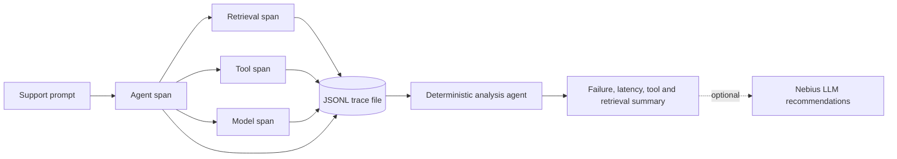

# Agent Observability and Trace Analysis

> A self-contained example for tracing agent runs, inspecting tool and retrieval behavior, and finding recurring reliability problems across multiple runs.

This project records nested agent activity as local JSONL spans. It captures prompts, retrieved context, tool inputs and outputs, model metadata, final outputs, latency, and exceptions. A deterministic analysis agent works without credentials; an optional Nebius-hosted model can turn the metrics into prioritized remediation advice.

## 🚀 Features

- **End-to-end agent traces**: Correlates agent, retrieval, tool, and model spans with trace and parent span IDs.
- **Useful reliability signals**: Records duration, status, errors, retrieved context, tool calls, model metadata, and final output.
- **Offline-first analysis**: Calculates failure patterns, retrieval misses, tool usage, average latency, and the slowest steps without an API key.
- **Optional LLM analysis**: Sends only the aggregated summary to Nebius Token Factory for prioritized recommendations.
- **Portable local format**: Writes newline-delimited JSON that is easy to inspect with `jq`, Python, DuckDB, or a log collector.
- **Runnable sample data**: Includes successful and failed traces under `sample_data/`.

## 🛠️ Tech Stack

- **Python 3.10+**: Workflow, tracing, and analysis.
- **JSONL**: Local append-only span storage.
- **OpenAI Python SDK**: Optional access to Nebius Token Factory's OpenAI-compatible endpoint.
- **pytest and Ruff**: Tests and code quality checks.

## Workflow



`SupportAgentWorkflow` is intentionally small so the instrumentation is easy to follow. Replace its offline response generator and toy tools with your real agent framework while keeping the recorder boundaries around each step.

## 📦 Getting Started

### Prerequisites

- Python 3.10+
- [uv](https://docs.astral.sh/uv/) or pip
- Optional: a [Nebius Token Factory](https://dub.sh/nebius) API key for LLM analysis

The trace generator and deterministic analyzer run entirely offline. No API key is required for the default workflow.

### Environment Variables

Copy the example environment file:

```bash
cp .env.example .env
```

Only `NEBIUS_API_KEY` is normally changed:

```env
NEBIUS_API_KEY="your_nebius_api_key"
NEBIUS_BASE_URL="https://api.studio.nebius.ai/v1"
NEBIUS_MODEL="meta-llama/Llama-3.3-70B-Instruct"
```

Prompts and tool values can contain sensitive information. Review or redact trace attributes before sending trace data to a third-party collector or model. The optional LLM path in this example sends the aggregated summary, not raw spans.

### Installation

1. Clone the repository and enter the project:

   ```bash
   git clone https://github.com/Arindam200/awesome-ai-apps.git
   cd awesome-ai-apps/advance_ai_agents/agent_observability_trace_analysis
   ```

2. Install dependencies:

   ```bash
   uv sync --extra dev
   ```

   Or with pip:

   ```bash
   python -m venv .venv
   source .venv/bin/activate
   pip install -e ".[dev]"
   ```

## ⚙️ Usage

### Generate and analyze traces locally

```bash
uv run python main.py
```

The command runs two successful support-agent requests and one simulated tool failure, writes `traces/agent_runs.jsonl`, and prints an analysis similar to:

Existing trace files are preserved by default. To intentionally replace the output from an earlier run, pass `--overwrite`:

```bash
uv run python main.py --overwrite
```

```json
{
  "trace_count": 3,
  "failure_count": 2,
  "failure_patterns": {"RuntimeError": 2},
  "tool_calls": {"ticket.lookup": 3},
  "retrieval_misses": 1,
  "slowest_steps": [
    {"name": "support_agent.run", "average_ms": 1.2}
  ]
}
```

Failures are counted at the span level. A tool exception therefore marks both the tool span and its enclosing agent span as errors, making propagation visible.

### Add LLM-powered recommendations

After setting `NEBIUS_API_KEY`:

```bash
uv run python main.py --trace-file traces/nebius_runs.jsonl --llm-analysis
```

This keeps the earlier local trace file unchanged. When repeating the Nebius run, add `--overwrite` to explicitly replace `traces/nebius_runs.jsonl`. The local analyzer creates a compact metrics summary first. The Nebius model receives that summary and returns three prioritized recommendations grounded in it.

### Analyze the committed sample data

```bash
uv run python -c 'from agent_observability import TraceAnalysisAgent; print(TraceAnalysisAgent().summarize("sample_data/traces.jsonl"))'
```

### Inspect traces directly

Each line is one span:

```bash
jq . traces/agent_runs.jsonl
jq 'select(.status == "error")' traces/agent_runs.jsonl
jq 'select(.kind == "tool") | {name, duration_ms, attributes, error}' traces/agent_runs.jsonl
```

Important fields are:

| Field | Purpose |
| --- | --- |
| `trace_id` | Connects all spans from one agent run. |
| `span_id` / `parent_span_id` | Reconstructs the nested execution tree. |
| `kind` | Distinguishes agent, retrieval, tool, and model work. |
| `status` / `error` | Shows success or a structured exception. |
| `duration_ms` | Supports latency aggregation and slow-step detection. |
| `attributes` | Stores prompts, context, tool data, model metadata, and outputs. |

## 📂 Project Structure

```text
agent_observability_trace_analysis/
├── agent_observability/
│   ├── __init__.py
│   ├── analysis.py       # Deterministic and optional LLM analysis agent
│   ├── tracing.py        # Nested JSONL span recorder
│   └── workflow.py       # Instrumented example support agent
├── sample_data/
│   └── traces.jsonl      # Successful and failed example spans
├── tests/
│   └── test_observability.py
├── .env.example
├── main.py
├── pyproject.toml
└── README.md
```

## 🧪 Development

Run the tests and lint checks:

```bash
uv run pytest
uv run ruff check .
uv run ruff format --check .
```

## Extending the Example

- Wrap real framework calls from LangGraph, CrewAI, Agno, or the OpenAI Agents SDK in recorder spans.
- Add token counts, cost, retry counts, or provider request IDs to model span attributes.
- Redact selected attributes before `_write` for production workloads.
- Export the same records to an OpenTelemetry collector, Phoenix, or another observability backend.
- Add a trace ID to user-visible errors so a failed run can be located quickly.

## 🤝 Contributing

Contributions are welcome. Please see the repository's [CONTRIBUTING.md](../../CONTRIBUTING.md) before opening a pull request.

## 📄 License

This project uses the repository's MIT license.

## 🙏 Acknowledgments

- [Nebius Token Factory](https://dub.sh/nebius) for optional model inference.
- [OpenTelemetry](https://opentelemetry.io/) for the trace and span terminology used by the local format.
