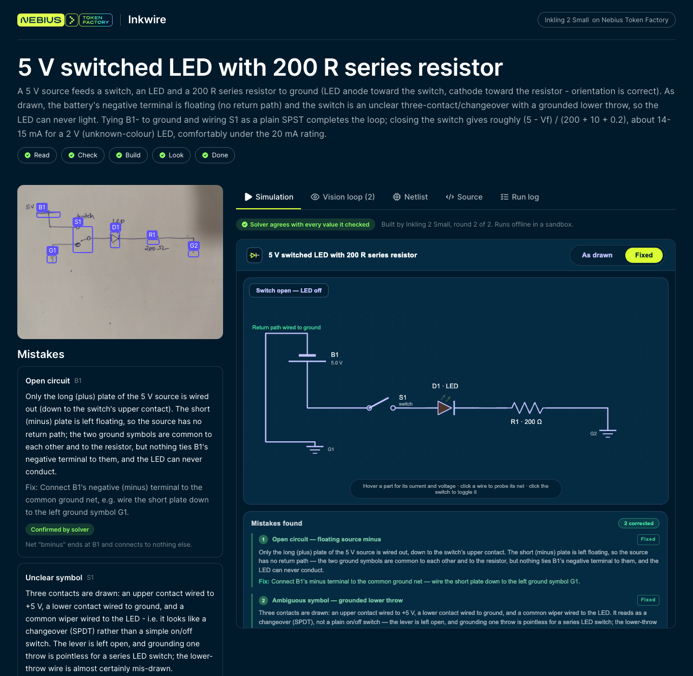
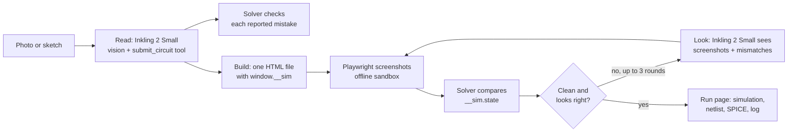

# Inkwire: Circuit Sketch → Live Simulation

> Photograph a hand-drawn circuit, mistakes and all, and get a working interactive simulation. Powered by Inkling 2 Small on [Nebius Token Factory](https://dub.sh/nebius).

Inkling 2 Small reads your drawing, lists what is wrong with it, and writes an interactive simulation of the corrected circuit as a single HTML page. Then it checks its own work by looking at screenshots of that page, next to your sketch, and fixes what looks wrong. A circuit solver built into the app checks every number the simulation shows, so you never have to take the model's word for the physics.

## 🚀 Features

- **Sketch in, simulation out**: upload a photo or scan, draw on the built-in sketch pad, or pick one of nine real hand-drawn circuits from open datasets
- **Mistakes found and checked**: a missing current-limit resistor, a reversed LED, a short, an open circuit or a missing value, each with a fix. The solver confirms which mistakes are real and adds any the model missed
- **A working simulation**: a schematic laid out like your drawing, switches you can click, value sliders, LEDs that glow with current, moving current dots, and an "As drawn / Fixed" toggle
- **Vision in the loop**: Playwright screenshots the page offline, and Inkling 2 Small compares the screenshots with your sketch and the solver's numbers, then fixes the page, for up to three rounds
- **Numbers you can trust**: the page exposes `window.__sim.state()`, and every node voltage and part current is checked against the solver
- **Engineer exports**: the netlist as JSON, a SPICE deck for ngspice or LTspice, the generated source with a diff per round, and a run log with tokens, time and cost for every call
- **Try it without a key**: replay mode serves recorded Inkling 2 Small runs for six of the examples

## 🛠️ Tech Stack

- **TypeScript, Next.js and React**: the app and its API routes
- **Inkling 2 Small on Nebius Token Factory**: reading the sketch (vision and a tool call), writing the simulation, and reviewing screenshots, through the OpenAI-compatible API
- **Playwright with headless Chromium**: offline screenshots of the generated page
- **A modified nodal analysis solver**, written for this project: batteries, resistors, potentiometers, LEDs, diodes, lamps, switches and capacitors
- **zod, jsonrepair and sharp**: structured output and image handling
- **Vitest**: tests that need no network

## Workflow



1. **Read.** One vision call turns the drawing into a netlist (parts, values, connections and where each part sits on the page), a list of mistakes with fixes, and a corrected netlist.
2. **Check.** The solver runs the netlist as drawn and marks each mistake as confirmed, not reproduced, or visual only.
3. **Build.** A second call writes the simulation as one self-contained HTML file.
4. **Look.** The app screenshots the page in a few states and reads `__sim.state()`. Inkling 2 Small gets the sketch, the screenshots and every value where its page disagrees with the solver, and returns either "ok" or a fixed file.

## 📦 Getting Started

### Prerequisites

- Node.js 22.13 or newer and [pnpm](https://pnpm.io/)
- An API key for [Nebius Token Factory](https://dub.sh/nebius)

### Environment Variables

Copy `.env.example` to `.env.local` and add your key:

```env
NEBIUS_API_KEY="your_nebius_token_factory_api_key"
```

The model (`thinkingmachines/Inkling-2-Small`), the endpoint and the prices for the cost column are already set; see `.env.example` for the optional overrides.

### Installation

```bash
git clone https://github.com/Arindam200/awesome-ai-apps.git
cd awesome-ai-apps/advance_ai_agents/circuit_sketch_to_simulation
pnpm install
pnpm browser            # downloads the Chromium build used for the screenshots
cp .env.example .env.local
```

## ⚙️ Usage

```bash
pnpm dev
```

Open http://localhost:3000, pick an example or upload a photo, and follow the run through Read, Check, Build, Look and Done. A run takes 3 to 12 minutes: Inkling 2 Small reasons at length before it writes a full HTML page.

To try it without a key, `INKLING_PROVIDER=replay pnpm dev` serves the recorded runs for six of the nine examples (all but "Lamp with two switches", "Three resistors in parallel" and "Source, switch and resistor, no values").

Other commands:

```bash
pnpm test                                       # solver, checks, SPICE export, parsing, CSP, and a recorded run (no network)
pnpm smoke fixtures/sketches/cghd-c31-d1.jpg    # one live run from the terminal
```

## 📊 Real runs

Six runs with Inkling 2 Small on Nebius Token Factory on 13 November 2026, on four sketches from the CGHD dataset and two from Wikimedia Commons. All six ended with the page matching the solver in every screenshot state.

| Sketch | What Inkling 2 Small found | Rounds | Time | Cost |
|---|---|---|---|---|
| LED with a switch, 5 V | Source minus wired to nothing (solver confirmed); unclear three-contact switch | 2 | 12.0 min | $0.130 |
| Switch, capacitor and LED | A gap that leaves the LED branch open (solver confirmed); the "1000 mF" unit flagged as unclear rather than guessed | 3 | 9.3 min | $0.133 |
| 9 V, 22 µF and an LED | No mistakes; every value matches the dataset authors' LTspice file | 1 | 5.8 min | $0.081 |
| Voltage divider, 9 V | No mistakes; matches the authors' LTspice file | 1 | 3.0 min | $0.044 |
| Potentiometer divider, annotated | No source voltage, no potentiometer value, an output that feeds nothing (all solver confirmed) | 1 | 5.8 min | $0.078 |
| Whiteboard LED and 1k resistor (±12 V) | Missing potentiometer value (solver confirmed) | 3 | 9.9 min | $0.151 |

The extra rounds fixed what only a look at the page shows: a capacitor shown still charging where the solver expected the steady state, a JavaScript error, a wire stopping 14 px short of an LED, and a label struck through by a wire.

Cost is the token usage returned by the Nebius Token Factory API multiplied by the list price for Inkling 2 Small ($0.30 per million input tokens, $0.06 cached, $1.00 output): **$0.62 for all six runs**, 21 model calls. About 89% of it is output, mostly reasoning before the HTML is written.

## 📂 Project Structure

```
src/
  app/                       pages and API routes (runs, run files, examples)
  components/                Start, SketchPad, RunView, Icon
  lib/
    inkling/client.ts        Token Factory client: streaming, usage, cost, replay and recording
    inkling/structured.ts    tool call, then JSON in text, then one repair turn
    inkling/read.ts          read prompt and the submit_circuit call
    inkling/build.ts         build and look prompts, HTML extraction, review parsing
    schema/circuit.ts        zod schemas for netlists, mistakes and the read
    sim/                     solver (mna.ts), device models, mistake checks, agreement, SPICE export
    sandbox.ts               Playwright screenshots in an offline, locked-down page
    pipeline.ts              read, check, build, look; saves the run after every step
fixtures/sketches/           nine hand-drawn circuits, with sources and licences
fixtures/replays/            recorded Inkling 2 Small replies for replay mode
scripts/smoke.mts            one live run from the command line
```

Runs are saved as plain folders in `data/runs/<id>/`: `run.json`, the sketch, each round's HTML and screenshots. Delete `data/` to start over.

## 🔒 A note on running generated code

The simulation is HTML and JavaScript written by the model, so the app keeps it contained:

- In the browser it runs in an `<iframe sandbox="allow-scripts">` with a Content Security Policy that blocks all network access, and it is never served as a page from the app's own origin (the API returns it as `text/plain`).
- Playwright loads it in an offline browser context with every non-`data:` request aborted.

That is a sensible guardrail for a **local demo**. Don't expose this app to other people with your own API key.

## ⚠️ Limitations

- The solver covers batteries, resistors, potentiometers, LEDs, diodes, lamps, on/off switches, push buttons, capacitors and ground. Transistors, op-amps, inductors, AC sources and changeover (SPDT) switches are out of scope: Inkling 2 Small may still read them, but the solver cannot check them.
- Hand drawings can be ambiguous. When a drawing can be read two ways, the model picks one and says so; the solver checks the reading, not the intent.

## 🤝 Contributing

Contributions are welcome! Please feel free to submit a Pull Request. See the [CONTRIBUTING.md](https://github.com/Arindam200/awesome-ai-apps/blob/main/CONTRIBUTING.md) for more details.

## 📄 License

This project is licensed under the MIT License - see the [LICENSE](https://github.com/Arindam200/awesome-ai-apps/blob/main/LICENSE) file for details. The example sketches keep their own CC BY-SA licences, and so does `assets/run.png`, which shows one of them; see [`fixtures/sketches/ATTRIBUTION.md`](./fixtures/sketches/ATTRIBUTION.md).

## 🙏 Acknowledgments

- [Thinking Machines](https://thinkingmachines.ai/model-card/inkling-2-small/) for Inkling 2 Small and its "vision in the loop" visual building
- [Nebius Token Factory](https://dub.sh/nebius) for serving it
- The [CGHD dataset](https://huggingface.co/datasets/lowercaseonly/cghd) and Wikimedia Commons contributors for the hand-drawn circuits
- Built by [Amitesh Anand](https://github.com/Astrodevil)
