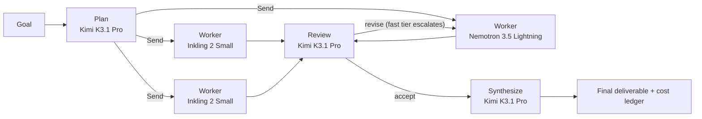

# Multi-Agent Orchestrator: Kimi K3.1 Pro + cheap workers

> One frontier model thinks, a team of cheap models works. A LangGraph orchestrator-worker multi-agent system on [Nebius Token Factory](https://dub.sh/nebius), with a live cost ledger that shows what you saved.

Give the orchestrator a goal. **Kimi K3.1 Pro** splits it into independent subtasks and routes each one to a tier: **Inkling 2 Small** for analysis, or **Nemotron 3.5 Lightning** for lookups and summaries. The workers run in parallel and check facts with Wikipedia and public web pages. Kimi then reviews every output and sends weak or wrong work back with specific feedback, and a cheap-tier task that gets sent back is redone on Inkling. Finally Kimi writes the deliverable. Kimi only does the three steps that need judgment, so most tokens are billed at worker prices.

## 🚀 Features

- **Orchestrator-worker multi-agent system in LangGraph**: `Send` fans subtasks out to parallel workers, and a single review node waits for all of them
- **Tiered routing**: Kimi tags each subtask `fast` or `standard`, so cheap work goes to the cheapest model
- **Review loop that catches mistakes**: Kimi accepts each output or sends it back with actionable feedback. Failed or empty work always goes back
- **Escalation**: a `fast` task that gets sent back is retried on the standard worker
- **Tool-using workers**: `wikipedia_search` and `fetch_url` (public URLs only), with no extra API keys
- **Cost ledger with live prices**: every model call is priced from the Token Factory `/v1/models` catalog, next to what the same tokens would cost on Kimi
- **Two front ends**: a Streamlit app that shows every worker live, and a Rich terminal CLI

## 🛠️ Tech Stack

- **Python 3.10+**
- **LangGraph**: the orchestrator graph, parallel fan-out with `Send`, custom stream events
- **LangChain + `langchain-nebius`**: `ChatNebius` for every model, tool calling, structured output
- **Nebius Token Factory**: Kimi K3.1 Pro, Inkling 2 Small, Nemotron 3.5 Lightning (or any cheaper worker you pick)
- **Streamlit** and **Rich**: web UI and terminal UI
- **httpx**: the keyless Wikipedia and web-page tools

## Workflow



1. **Plan**: Kimi returns a structured plan with 2 to N independent subtasks, each with a self-contained brief, a tier, and the shape of the final deliverable.
2. **Work**: one `Send` per subtask. Workers run at the same time, call tools when they need facts, and return Markdown.
3. **Review**: Kimi sees every output next to its brief and accepts or revises each one. Revisions go back out in parallel, then the graph returns to review until the review budget runs out.
4. **Synthesize**: Kimi merges the accepted work into one document and streams it out.

### What a run looks like

One real run with the default settings, using the five-database example goal (prices on 2026-11-16):

- **Plan**: Kimi split the goal into 4 subtasks in 17 s. It gave three to Inkling 2 Small and the MongoDB assessment, as a fast-tier task, to Nemotron 3.5 Lightning.
- **Work**: the 4 workers ran in parallel and checked facts against sqlite.org, postgresql.org, duckdb.org, clickhouse.com, mongodb.com and Wikipedia. All four finished within 15 s of starting.
- **Review**: Kimi accepted three outputs and sent the MongoDB one back. Nemotron had written "max 64MB document size" and listed needing multi-document ACID transactions as a reason to leave MongoDB. Kimi's feedback: the maximum BSON document size is 16MB, and MongoDB does support multi-document ACID transactions. The retry escalated to Inkling 2 Small, which fixed both claims in 6.5 s.
- **Result**: 20 model calls, 50,079 tokens, **$0.085**, 109 s end to end. The same tokens all on Kimi would cost $0.19, so the run cost 56% less. Workers handled 74% of the tokens.

## 📦 Getting Started

### Prerequisites

- Python 3.10+
- [uv](https://github.com/astral-sh/uv) (recommended) or pip
- A [Nebius Token Factory](https://dub.sh/nebius) API key. That's the only key you need.

### Environment Variables

```bash
cp .env.example .env
```

```env
NEBIUS_API_KEY="your_nebius_token_factory_api_key"

# Optional overrides
# ORCHESTRATOR_MODEL="moonshotai/Kimi-K3.1-Pro"
# WORKER_MODEL="thinkingmachines/Inkling-2-Small"
# FAST_WORKER_MODEL="nvidia/Nemotron-3_5-Lightning"
# ORCHESTRATOR_REASONING="medium"
# WORKER_REASONING="low"
```

If your key can't call Kimi K3.1 Pro, the orchestrator falls back to Kimi K3 automatically.

### Installation

1. **Clone the repository:**

   ```bash
   git clone https://github.com/Arindam200/awesome-ai-apps.git
   cd awesome-ai-apps/advance_ai_agents/multi_agent_orchestrator
   ```

2. **Install dependencies:**

   ```bash
   uv sync
   ```

   or with pip:

   ```bash
   python -m venv .venv && source .venv/bin/activate
   pip install -e .
   ```

## ⚙️ Usage

### Web app

```bash
uv run streamlit run app.py
```

Open http://localhost:8501, pick an example goal or write your own, and click **Run the agents**. You'll see the plan, a live card per worker with its latest tool call, Kimi's review verdicts, the final answer streaming in, and the cost ledger. The sidebar lets you pick the orchestrator, both worker tiers, the number of subtasks, the number of review rounds and whether workers can use tools.

### Terminal

```bash
uv run main.py "Compare Postgres, SQLite, DuckDB and MongoDB for a solo developer's analytics SaaS"
```

Options:

| Flag | Default | What it does |
| --- | --- | --- |
| `--worker` | `thinkingmachines/Inkling-2-Small` | Standard-tier worker, also used for every revision |
| `--fast-worker` | `nvidia/Nemotron-3_5-Lightning` | Fast-tier worker, first attempt only |
| `--max-tasks` | `5` | Upper limit on subtasks (Kimi often uses fewer) |
| `--revisions` | `1` | Review rounds that may send work back. `0` skips review |
| `--no-tools` | off | Workers answer from their own knowledge |
| `--out FILE` | none | Save the final deliverable as Markdown |

### Example goals

- "Plan a one-week launch for an open-source CLI that turns screenshots into Markdown docs: channels, content calendar, launch-day checklist and success metrics."
- "Explain how CRISPR gene editing works, its approved medical uses so far, and the open ethical debates, for a smart high-school student."
- "Compare Postgres, SQLite, DuckDB, MongoDB and ClickHouse for a solo developer building a SaaS analytics dashboard. Recommend one and explain when to switch."

## 🧠 Models

| Role | Default | Price per 1M tokens (in / out) |
| --- | --- | --- |
| Orchestrator: plan, review, synthesize | `moonshotai/Kimi-K3.1-Pro` | $2.00 / $10.00 |
| Standard worker and revisions | `thinkingmachines/Inkling-2-Small` | $0.30 / $1.00 |
| Fast worker | `nvidia/Nemotron-3_5-Lightning` | $0.06 / $0.24 |

Other worker options in the app: MiniMax M3.1 Flash, GPT-OSS 120B, GLM-5.3 Flash and Qwen3 30B A3B. All of them support tool calling. Prices are list prices on 2026-11-16; the app reads the live catalog on every start.

Kimi K3.1 Pro supports tool calling but not JSON mode, so plans and reviews use structured output through tool calling.

The default models all reason before they answer, so the app sets `reasoning_effort` per role:

- **Orchestrator, `medium`**: in our runs a review took 16 to 40 s and used 0.8k to 2.3k reasoning tokens. Without a limit, one review of four outputs took over two minutes and 9k reasoning tokens.
- **Workers, `low`**: workers do focused, tool-backed subtasks and Kimi checks them. At the default effort, Inkling 2 Small once spent its entire 8k-token budget reasoning about a revision and returned nothing. With `low`, a typical answer takes about 3 s instead of 15 s. If a worker still returns an empty reply, it gets one short retry.

## 📂 Project Structure

```
multi_agent_orchestrator/
├── orchestrator.py   # LangGraph graph: plan -> Send workers -> review loop -> synthesize, plus the event stream
├── prompts.py        # Orchestrator and worker prompts
├── models.py         # ChatNebius factory, model roster, live pricing, orchestrator fallback
├── tools.py          # wikipedia_search and fetch_url (public URLs only)
├── app.py            # Streamlit UI
├── main.py           # Rich terminal UI
├── .streamlit/       # Dark theme, local-only server
├── .env.example
└── pyproject.toml
```

## 🔧 How it works in code

- **Fan-out**: `dispatch()` returns one `Send("worker", {...})` per subtask. The `worker` node takes its own input schema, so each worker sees only the goal and its brief.
- **Fan-in**: `results` uses a reducer keyed by task id, so parallel writes merge and a revision replaces the earlier attempt. `worker -> review` is a plain edge, so review runs once, after every worker in the step has finished.
- **Loop**: `after_review()` returns more `Send`s for the tasks sent back, or `"synthesize"`.
- **Live UI**: nodes push progress such as `tool_call` and `final_delta` with `get_stream_writer()`, and `run()` merges those with node updates (`stream_mode=["custom", "updates", "values"]`) into one event stream for both front ends.

## 🔒 Safety notes

- `fetch_url` only fetches public `http(s)` URLs. It resolves each host once and refuses any private, loopback, link-local or metadata address. It then connects to the exact address it checked, so DNS rebinding can't swap in a local one, while TLS is still verified against the real hostname. Every redirect hop is checked again.
- Worker prompts tell the model to treat tool output as data, never as instructions. Kimi's review is a second check, not a guarantee. Verify important facts before you rely on them.
- The Streamlit server binds to `localhost` only.

## 🤝 Contributing

Contributions are welcome! Please feel free to submit a Pull Request. See the [CONTRIBUTING.md](https://github.com/Arindam200/awesome-ai-apps/blob/main/CONTRIBUTING.md) for more details.

## 📄 License

This project is licensed under the MIT License - see the [LICENSE](https://github.com/Arindam200/awesome-ai-apps/blob/main/LICENSE) file for details.

## 🙏 Acknowledgments

- [Nebius Token Factory](https://dub.sh/nebius) for serving every model in the system
- [LangGraph](https://langchain-ai.github.io/langgraph/) for the orchestration runtime
- Moonshot AI (Kimi K3.1 Pro), Thinking Machines (Inkling 2 Small) and NVIDIA (Nemotron 3.5 Lightning) for the models
