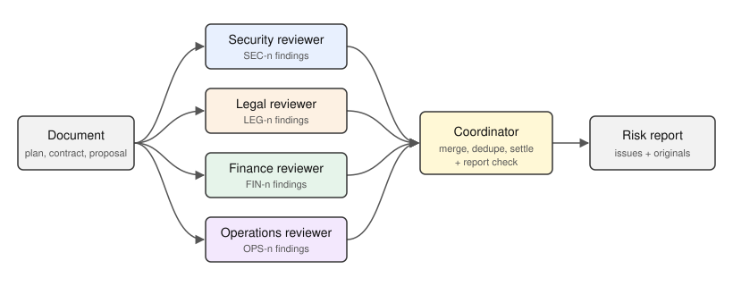

# Multi-Agent Risk Review

> Four reviewer agents check one proposal, contract or deployment plan from the security, legal, finance and operations side, and a coordinator merges what they found into one risk report.

Give it a document, and a LangGraph workflow sends it to four specialized reviewers in parallel.
Each returns structured findings with a risk level, a quote from the document and its reasoning.
A coordinator agent merges duplicates, settles disagreements about severity and writes the final report.
Built with **LangGraph**, **Pydantic** structured outputs and **Nebius Token Factory**.

## 🚀 Features

- **Four independent reviewers**: security, legal, finance and operations each make their own model call on the same document, in parallel.
- **Structured findings**: every finding is a Pydantic object with a title, a risk level (`low`, `medium`, `high` or `critical`), a quote from the document as evidence, the reasoning and a recommendation.
- **Coordinator merge**: findings about the same problem become one issue that lists the IDs it covers (`SEC-1`, `LEG-2`, ...). When reviewers rate a problem differently, the coordinator keeps the higher level unless quoted evidence shows a mitigation, and says why.
- **Report check**: code checks the coordinator's work. An ID no reviewer raised, a finding no issue cites, a finding cited by more than one issue, or an issue rated below its most severe finding is printed under "Validation warnings" instead of being fixed silently.
- **Original findings kept**: the report ends with every reviewer's own findings, so the merged wording can be checked against them.

## 🛠️ Tech Stack

- **Python 3.10+**
- **[LangGraph](https://github.com/langchain-ai/langgraph)**: parallel fan-out to the reviewers, then a join into the coordinator
- **[Pydantic](https://docs.pydantic.dev/)**: structured outputs for the findings and the report
- **[langchain-openai](https://pypi.org/project/langchain-openai/)**: OpenAI-compatible client pointed at [Nebius Token Factory](https://dub.sh/nebius)

## Workflow



1. **Reviewers**: the security, legal, finance and operations nodes each read the whole document with their own prompt and return a list of findings. Code gives each finding an ID with the reviewer's prefix, so the model never invents IDs.
2. **Coordinator**: receives every finding with its ID and returns a report: a summary and the merged issues, each with the IDs it covers and, where reviewers disagreed, how the level was chosen.
3. **Report check**: code compares the cited IDs and risk levels with the findings and records any mismatch as a warning.

## 📦 Getting Started

### Prerequisites

- Python 3.10+
- [uv](https://github.com/astral-sh/uv) (recommended) or pip
- An API key for [Nebius Token Factory](https://dub.sh/nebius)

### Environment Variables

Copy `.env.example` to `.env` in this folder and add your key:

```env
NEBIUS_API_KEY="your_nebius_api_key"

# Optional
NEBIUS_MODEL="Qwen/Qwen3-30B-A3B-Instruct-2507"
NEBIUS_BASE_URL="https://api.tokenfactory.nebius.com/v1/"
```

The `.env` file is read from this project folder, whichever directory you run from.

### Installation

```bash
git clone https://github.com/Arindam200/awesome-ai-apps.git
cd awesome-ai-apps/advance_ai_agents/multi_agent_risk_review
uv sync                # or: pip install -e .
cp .env.example .env   # add your NEBIUS_API_KEY
```

## ⚙️ Usage

Review the bundled sample, a fictional vendor rollout plan:

```bash
uv run python main.py samples/vendor_rollout_plan.md
# with pip: python main.py samples/vendor_rollout_plan.md
```

Pass any text or Markdown file the same way, and choose another model with `--model`.
The report prints to stdout as Markdown, so `> report.md` saves it.

[`examples/sample_report.md`](examples/sample_report.md) is the unedited output of one run on the sample, made with a small local model; its header says which.

Run the tests, which use a fake model and make no API calls:

```bash
uv run python tests/test_graph.py
# with pip: python tests/test_graph.py
```

## 📂 Project Structure

```
multi_agent_risk_review/
├── graph.py                     # Schemas, reviewer and coordinator nodes, report check, rendering
├── main.py                      # CLI entrypoint
├── samples/
│   └── vendor_rollout_plan.md   # Fictional deployment plan to review
├── examples/
│   └── sample_report.md         # Output of one run on the sample
├── tests/
│   └── test_graph.py            # End-to-end graph tests with a fake model
├── assets/
│   └── workflow.svg             # Workflow diagram
├── pyproject.toml               # Dependencies (uv/pip)
├── .env.example                 # Required and optional environment variables
└── README.md
```

## 🔍 Technical Notes

- **Default model:** `Qwen/Qwen3-30B-A3B-Instruct-2507` on Nebius Token Factory, the same default as the [Briefing Room](../meeting_briefing_agent) agent. Set `NEBIUS_MODEL` or pass `--model` to try a larger model.
- **The report is model output.** Reviewers are told to quote the document and not to invent facts, but a model can still overstate a risk, so check the evidence quotes before acting on a finding.
- **The report check proves references, not wording.** It confirms that every cited ID exists and that every finding is cited, and it warns when a finding is cited twice or an issue is rated below its most severe finding. It cannot prove the merged text kept each point, which is why the original findings are printed too.

## 🤝 Contributing

Contributions are welcome! Please feel free to submit a Pull Request. See the [CONTRIBUTING.md](https://github.com/Arindam200/awesome-ai-apps/blob/main/CONTRIBUTING.md) for more details.

## 📄 License

This project is licensed under the MIT License - see the [LICENSE](https://github.com/Arindam200/awesome-ai-apps/blob/main/LICENSE) file for details.

## 🙏 Acknowledgments

- [LangGraph](https://github.com/langchain-ai/langgraph) for the graph runtime.
- [Nebius Token Factory](https://dub.sh/nebius) for model inference.
