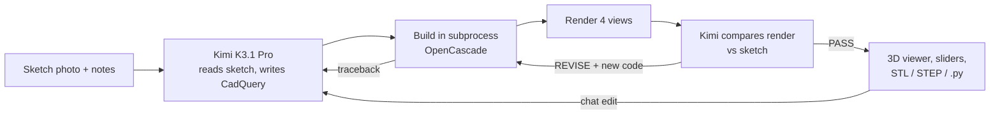

# Napkin → 3D Print

> Sketch a part on paper, snap a photo, and get a printable, parametric STL. Powered by Kimi K3.1 Pro on [Nebius Token Factory](https://dub.sh/nebius).

Kimi K3.1 Pro reads your hand-drawn sketch, including any dimensions you scribbled on it, and writes a parametric [CadQuery](https://github.com/CadQuery/cadquery) model. The app builds the solid, renders it from four angles, and shows Kimi its own render next to your sketch. Kimi then either signs off or fixes what's wrong. Build errors go back to Kimi as tracebacks, so it debugs its own CAD code.

You end up with a part that prints itself layer by layer in an interactive 3D viewer, sliders for every dimension, and STL, STEP and Python downloads.

## 🚀 Features

- **Sketch in, STL out**: upload a photo, use your webcam, or pick one of the bundled sample sketches
- **Self-reviewing CAD agent**: Kimi compares its four-view render with your drawing and revises until a person would recognise their sketch
- **Self-debugging builds**: OpenCascade errors are fed back to Kimi with the traceback, up to three fixes per version
- **Parametric sliders**: Kimi exposes the dimensions that matter (width, angle, wall thickness, hole size) as `PARAMS`. Moving a slider rebuilds the part locally with no model call
- **Edit by chat**: "add a 10 mm cable hole through the back" edits the code, rebuilds and re-renders
- **3D print preview**: a Three.js viewer animates the part printing onto a 220 mm bed, then lets you orbit it
- **Print-ready checks**: watertight mesh, single solid, valid B-rep, size, volume and estimated PLA weight
- **Design timeline**: every version Kimi built, with its interpretation, review notes, the build errors it fixed, and the code

## 🛠️ Tech Stack

- **Python**: core language
- **Streamlit**: web interface
- **Kimi K3.1 Pro on Nebius Token Factory**: vision, CAD code generation and self-review through the OpenAI-compatible API
- **CadQuery / OpenCascade**: parametric solid modeling, STL and STEP export
- **trimesh + Matplotlib**: mesh checks and headless four-view renders (no OpenGL needed)
- **Three.js**: in-browser 3D viewer with the print animation

## Workflow



1. Kimi reads the sketch and writes a CadQuery module with a `PARAMS` dict and a `build(p)` function.
2. `cad_runner.py` checks the code against an import allowlist, builds it in a separate process, centers the part on the bed and exports STL and STEP.
3. `render.py` renders front, right, top and isometric views with the measured size printed on them.
4. Kimi sees both images side by side and answers `VERDICT: PASS` or `VERDICT: REVISE` with corrected code. This repeats for the number of review rounds you choose.

## 📦 Getting Started

### Prerequisites

- Python 3.11 or newer (required by CadQuery 2.8)
- [uv](https://github.com/astral-sh/uv) (recommended) or pip
- A [Nebius Token Factory](https://dub.sh/nebius) API key

### Environment Variables

```bash
cp .env.example .env
```

```env
NEBIUS_API_KEY="your_nebius_token_factory_api_key"
# Optional, defaults to moonshotai/Kimi-K3.1-Pro with automatic fallback to moonshotai/Kimi-K3
# KIMI_MODEL="moonshotai/Kimi-K3.1-Pro"
```

### Installation

1. **Clone the repository:**

   ```bash
   git clone https://github.com/Arindam200/awesome-ai-apps.git
   cd awesome-ai-apps/advance_ai_agents/napkin_to_3d_print
   ```

2. **Install dependencies** (the CadQuery download is a few hundred MB):

   ```bash
   uv sync
   ```

   Or with pip:

   ```bash
   python -m venv .venv && source .venv/bin/activate
   pip install -e .
   ```

## ⚙️ Usage

```bash
uv run streamlit run app.py
```

Open http://localhost:8501, then:

1. Upload a photo of your sketch, take one with the **Camera** tab, or open **Samples** and pick the phone stand, wall hook or pen cup.
2. Optionally add notes, such as "fits an iPhone 16 at 60°" or "M4 screws, 3 mm walls".
3. Click **Model it** and watch Kimi think, build, review and revise.
4. Move the sliders, ask for changes, then download the STL and print it.

**Tips**

- Write the important dimensions on the sketch. Kimi reads them and keeps them exact.
- Two views (side and front) work much better than one perspective doodle.
- `high` reasoning effort is the default. Use `low` for faster chat edits and `max` for tricky parts.

## 📂 Project Structure

```
napkin_to_3d_print/
├── app.py           # Streamlit UI: input, live progress, viewer, sliders, chat edits, timeline
├── cad_agent.py     # Design -> build -> render -> critique loop and all prompts
├── cad_runner.py    # Subprocess that checks, builds and exports the CadQuery model
├── render.py        # Headless four-view renders and mesh checks
├── viewer.py        # Three.js viewer with the layer-by-layer print animation
├── kimi.py          # Nebius Token Factory client, model fallback and streaming
├── samples/         # Hand-drawn sample sketches
├── assets/          # README images
├── .env.example
└── pyproject.toml
```

## 🔒 A note on running generated code

The CadQuery code Kimi writes runs on your machine, so the app takes a few precautions:

- It builds in a separate process with a 120 s timeout and an **empty environment**, so generated code never sees `NEBIUS_API_KEY`.
- It refuses code that imports anything except `cadquery`, `math` and `numpy`, or that touches builtins like `open`/`exec`/`eval`, dunder attributes, or NumPy/CadQuery file I/O.
- `.streamlit/config.toml` binds the server to `localhost`.

That's a sensible guardrail for a **local demo, not a security sandbox**. Don't expose this app to other people as is. For a shared deployment, run `cad_runner.py` inside a real isolation boundary (a container or remote sandbox with no network and a read-only filesystem).

## 🤝 Contributing

Contributions are welcome! Please feel free to submit a Pull Request. See the [CONTRIBUTING.md](https://github.com/Arindam200/awesome-ai-apps/blob/main/CONTRIBUTING.md) for more details.

## 📄 License

This project is licensed under the MIT License - see the [LICENSE](https://github.com/Arindam200/awesome-ai-apps/blob/main/LICENSE) file for details.

## 🙏 Acknowledgments

- [Moonshot AI](https://www.kimi.ai/blog/kimi-k3-1-pro) for Kimi K3.1 Pro and its strong CAD-code generation (BenchCAD)
- [Nebius Token Factory](https://dub.sh/nebius) for serving it
- [CadQuery](https://github.com/CadQuery/cadquery), [trimesh](https://github.com/mikedh/trimesh) and [three.js](https://threejs.org/)
