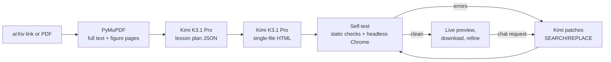

# Paper → Interactive Explainer

> Turn any research paper into a Distill-style interactive explainer you can play with. Powered by Kimi K3.1 Pro on [Nebius Token Factory](https://dub.sh/nebius).

Paste an arXiv link or upload a PDF. Kimi K3.1 Pro reads the whole paper in one pass, figures included, thanks to its 1M-token context and vision. It designs a lesson where every core idea becomes something you can drag, slide or step through, then builds it as a single self-contained HTML page. The app loads that page in headless Chrome, collects any JavaScript errors, and has Kimi patch them before you ever see the page.

## 🚀 Features

- **Whole-paper reading**: full text plus renders of the figure-heavy pages go to Kimi in one request, with no chunking or RAG
- **Lesson plan first**: Kimi designs 4-6 sections, each with its own interactive widget, before writing any code. You can watch the plan appear
- **One-file explainers**: inline CSS and JS, SVG/canvas visuals, KaTeX math, light and dark themes, mobile layout, glossary tooltips and a quiz
- **Grounded in the paper**: key results quote the paper's own numbers and cite their table or section
- **Self-tested**: an optional Playwright run loads the page, scrolls it, pokes every slider, and feeds console errors back to Kimi, which fixes them with targeted SEARCH/REPLACE patches
- **Refine by chat**: "let me type my own sentence into the attention widget" becomes a patch, a re-test and a new version
- **Audience presets**: curious beginner, software engineer or researcher
- **Shareable output**: every version is saved to `outputs/` and can be downloaded as a standalone `.html`

## 🛠️ Tech Stack

- **Python**: core language
- **Streamlit**: web interface
- **Kimi K3.1 Pro on Nebius Token Factory**: long-context reading, vision, lesson design and front-end code generation
- **PyMuPDF**: PDF text extraction and figure-page rendering
- **Playwright (optional)**: headless Chrome self-test
- **KaTeX / SVG / Canvas / three.js**: what the generated explainers are built with

## Workflow



1. **Read**: `paper.py` pulls the PDF from arXiv (or takes your upload), extracts every page of text and renders up to eight pages that contain figures.
2. **Plan**: Kimi returns a JSON lesson plan with sections, widget specs, key results, limitations, glossary and quiz.
3. **Build**: Kimi writes the page from the plan and the full paper. If it hits the output limit, it's asked to continue from where it stopped.
4. **Self-test**: static checks (truncation, missing sections) plus, if Playwright is installed, a headless Chrome run that records page errors and console errors. Kimi gets up to two passes to fix them.

## 📦 Getting Started

### Prerequisites

- Python 3.10+
- [uv](https://github.com/astral-sh/uv) (recommended) or pip
- A [Nebius Token Factory](https://dub.sh/nebius) API key

### Environment Variables

```bash
cp .env.example .env
```

```env
NEBIUS_API_KEY="your_nebius_token_factory_api_key"
# Optional, defaults to moonshotai/Kimi-K3.1-Pro with automatic fallback to moonshotai/Kimi-K3
# KIMI_MODEL="moonshotai/Kimi-K3.1-Pro"
```

### Installation

1. **Clone the repository:**

   ```bash
   git clone https://github.com/Arindam200/awesome-ai-apps.git
   cd awesome-ai-apps/advance_ai_agents/paper_to_interactive_explainer
   ```

2. **Install dependencies:**

   ```bash
   uv sync
   ```

3. **Optional: enable the headless-Chrome self-test** (recommended):

   ```bash
   uv sync --extra qa
   uv run playwright install chromium
   ```

## ⚙️ Usage

```bash
uv run streamlit run app.py
```

Open http://localhost:8501, then:

1. Paste an arXiv link or ID (for example `1706.03762`), click one of the example papers, or upload a PDF.
2. Pick an audience in the sidebar.
3. Click **Build the explainer**. You'll see the paper card, then the lesson plan, then the page being written live, then the self-test.
4. Play with the explainer inline, download it, or ask for changes in **Refine it**.

A full build with `high` reasoning effort usually takes a few minutes, because Kimi writes a lot of code. Use `low` for faster refinements.

## 📂 Project Structure

```
paper_to_interactive_explainer/
├── app.py               # Streamlit UI: input, live progress, plan cards, preview, refine, versions
├── explainer_agent.py   # Plan -> build -> self-test -> patch loop and all prompts
├── paper.py             # arXiv / PDF loading, text extraction, figure-page renders
├── qa.py                # Headless Chrome self-test (Playwright), run as a subprocess
├── kimi.py              # Nebius Token Factory client, model fallback and streaming
├── outputs/             # Generated explainers (git-ignored)
├── assets/              # README images
├── .env.example
└── pyproject.toml
```

## ⚠️ Accuracy

Kimi is told to use only numbers that appear in the paper and to cite where each idea comes from. Explainers are still a teaching aid, not a substitute for the paper. Check important claims against the original.

## 🤝 Contributing

Contributions are welcome! Please feel free to submit a Pull Request. See the [CONTRIBUTING.md](https://github.com/Arindam200/awesome-ai-apps/blob/main/CONTRIBUTING.md) for more details.

## 📄 License

This project is licensed under the MIT License - see the [LICENSE](https://github.com/Arindam200/awesome-ai-apps/blob/main/LICENSE) file for details.

## 🙏 Acknowledgments

- [Moonshot AI](https://www.kimi.ai/blog/kimi-k3-1-pro) for Kimi K3.1 Pro
- [Nebius Token Factory](https://dub.sh/nebius) for serving it
- Inspired by [Distill.pub](https://distill.pub/) and [Bartosz Ciechanowski](https://ciechanow.ski/)'s interactive essays
