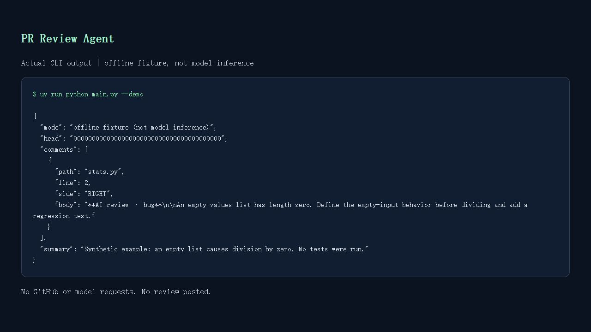

# PR Review Agent

> Preview a structured review of a GitHub pull request, then explicitly choose whether to post it.

A small Agno + Nebius example that fetches GitHub patches with PyGithub, reviews bugs,
style and missing tests, and validates each proposed inline location. It follows a
fetch → analyze → validate → preview → optional publish workflow.



The screenshot is the output of `--demo`: a synthetic fixture, not model inference or
evidence that a real PR was reviewed.

## Features

- **Preview by default:** a normal run prints JSON and performs no GitHub writes.
- **Explicit publication:** `--post` creates one `COMMENT` review, never an approval.
- **Diff locations:** only added RIGHT-side lines in fetched patches can receive findings.
- **Snapshot checks:** reject changed head/base commits before posting; pin the review to the head.
- **Bounded context:** reject more than 60 files, missing/incomplete patches, or over 100,000
  patch characters rather than silently reviewing a partial selection.
- **Offline demo and tests:** inspect the workflow without credentials or inference costs.

## Tech Stack

- Python 3.11+ (tested with 3.12)
- Agno with its Nebius Token Factory model adapter
- PyGithub for PR snapshots and batched inline review submission
- Pydantic for strict structured findings; pytest and Ruff for local checks

## Workflow

1. Parse a canonical `https://github.com/OWNER/REPO/pull/NUMBER` URL.
2. Read the open PR and changed-file patches; check patch size/completeness and snapshot stability.
3. Send the title and patches to one tool-free Agno reviewer, using your configured Nebius model.
4. Validate the structured response and every inline location. Invalid output aborts the review.
5. Print the review. With `--post`, refresh the PR and submit the comments on the inspected SHA.

PR content is untrusted data. The model has no execution or GitHub tools; the Python
publisher enforces the write gate and line checks outside the model. This reduces risk but
does not establish that a model's findings are correct. Review the preview yourself.

## Getting Started

### Prerequisites

- Python 3.11+ and [uv](https://docs.astral.sh/uv/)
- A GitHub token with read access to the target repository. Only publishing needs
  pull-request write permission. Classic tokens on public repos may use `public_repo`;
  prefer a fine-grained token scoped to the intended repository and permissions.
- A Nebius Token Factory key and a model available in your account that supports the
  structured-output behavior used by Agno. Live runs may incur inference charges.

### Installation

```bash
git clone https://github.com/Arindam200/awesome-ai-apps.git
cd awesome-ai-apps/advance_ai_agents/pr_review_agent
uv sync --python 3.12
```

### Environment Variables

Copy `.env.example` to `.env` in this directory and configure:

```dotenv
GITHUB_TOKEN=your_repository_scoped_token
NEBIUS_API_KEY=your_nebius_key
NEBIUS_MODEL=your_available_model_id
```

Existing environment variables take precedence. Keep the file local and never share real
keys in logs or reviews. The root `.gitignore` excludes `.env` and virtual environments.
PR code and title are sent to Nebius during live analysis: use repositories whose contents
you are authorized to send to that provider.

## Usage

### Offline fixture preview

```bash
uv run python main.py --demo
```

This prints a predetermined finding about a synthetic division-by-zero example. It calls
neither GitHub nor a model and cannot be combined with `--post`.

### Analyze and preview a real PR

```bash
uv run python main.py https://github.com/OWNER/REPO/pull/123
```

Inspect the JSON summary/findings. No review is posted. A model can miss defects or give
false positives; only diff context is available, not full files or repository history.

### Publish explicitly

```bash
uv run python main.py https://github.com/OWNER/REPO/pull/123 --post
```

This performs a new analysis and publishes its output immediately after validation; it is
not a replay of a previous preview. Only use this when you intend to publish the new result.
If the PR closes or its head/base changes, rerun. The check is not an atomic lock: GitHub
can still update the PR after the refresh, but the review is tied to the inspected commit.
Each invocation can create another review; there is no deduplication across runs.

### Test execution and limitations

This example **does not execute PR code or its tests**. Running untrusted PR tests needs a
separately configured disposable sandbox with no host secrets; automatic sandbox execution
is the optional extension from issue #367, not part of this example. All review bodies state
that tests were not executed. The review agent has no credentials in its prompt, although
credentials accidentally committed in a target diff would be included with that code.

Missing/binary patches or truncated additions are rejected. GitHub can omit deletion context
without an additions mismatch; manual review is still needed for API-truncated/large diffs.
No live Nebius model quality, external test sandbox, or real GitHub write was tested during
development. Offline tests exercise real adapter parsing through a mock HTTP transport and
the write boundary using mocks.

## Development

```bash
uv sync --all-groups --python 3.12
uv run ruff check .
uv run ruff format --check .
uv run pytest -q
```

Tests cover diff offsets, added-line validation, missing/truncated patches, size limits,
moving/closed PRs, duplicate locations, default preview, the explicit posting gate, exception
redaction, and Agno/Nebius request construction with an offline HTTP response fixture.

## Project Structure

```text
pr_review_agent/
├── main.py          # CLI, environment, preview and explicit write gate
├── review.py        # Snapshot, agent, diff validation and publisher
├── demo.json        # Labeled synthetic offline fixture
├── tests/           # Offline unit and adapter integration tests
├── assets/demo.png  # Screenshot of actual fixture output
├── .env.example
├── pyproject.toml
└── README.md
```

## Contributing

Follow the repository's [contribution guide](../../CONTRIBUTING.md). Keep extensions scoped
and add tests for any new publishing or execution behavior.

## License

MIT, matching the repository [license](../../LICENSE).

## Acknowledgments

Built for maintainer-requested [issue #367](https://github.com/Arindam200/awesome-ai-apps/issues/367)
using Agno, Nebius Token Factory, PyGithub and Pydantic.
