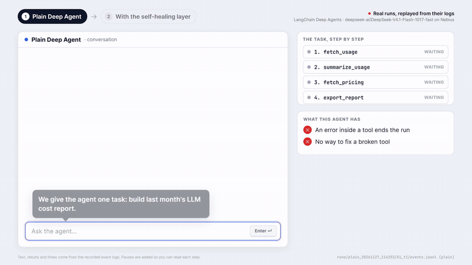
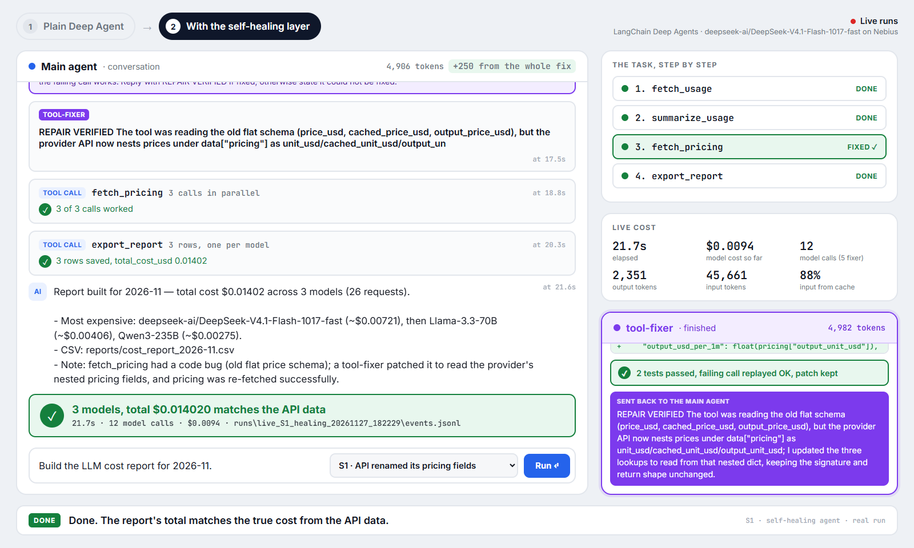

# Self-Healing Agent with LangChain Deep Agents

> An agent that repairs its own broken tools, tests the fix before keeping it, and knows when the right move is to leave the code alone.

Agents fail in boring ways. An API renames a field overnight, a log export starts sending numbers as `"1,240"`, a CSV writer quietly drops a column. Usually a person has to wake up, read the traceback and push a one-line fix.

This agent does that itself. It builds a monthly LLM cost report through four tools. When one of them breaks, it works out **what kind** of failure it is. Only real code bugs get a patch. The patch is written by a `tool-fixer` sub-agent, and it's kept only if the tool's tests pass and the call that failed now works. A rate limit, a wrong argument or an expired key never touches the code.

It runs on [LangChain Deep Agents](https://docs.langchain.com/oss/python/deepagents/overview) with DeepSeek-V4.1-Flash-1017-fast on [Nebius Token Factory](https://tokenfactory.nebius.com).

## 🚀 Features

- **Fixes real code bugs**: renamed API fields, messy input data, wrong output, a pagination bug
- **Knows when not to**: retries HTTP 429s, corrects its own bad arguments after a 404, and stops on an expired key (401) with a clear message for a person
- **Catches silent failures**: output contracts flag a tool that "worked" but returned the wrong thing
- **A dedicated repair sub-agent**: the `tool-fixer` works in its own context, so the main agent's stays small
- **Guardrails on every patch**: tools/ allowlist, syntax check, backup, isolated pytest, replay of the failed call, rollback, 2 attempts per tool
- **Read-only filesystem**: the agent can read tools, tests and failure reports, but `repair_tool` is the only way to change code
- **Benchmark included**: 9 situations, same task and harness, scored on outcome and on whether it touched only what it should
- **Plain baseline included**: the same task on a default Deep Agent, to see what goes wrong without the healing layer
- **Optional live view**: watch a run in your browser, or replay a recorded one at its real speed
- **Every run is recorded**: timed events, streamed tokens, token usage and cost

## 🛠️ Tech Stack

- **[LangChain Deep Agents](https://docs.langchain.com/oss/python/deepagents/overview)** (`deepagents`): agent harness, `task` sub-agents, middleware, filesystem tools and permissions
- **[LangChain OpenAI](https://docs.langchain.com/oss/python/integrations/chat/openai)**: `ChatOpenAI` pointed at Nebius's OpenAI-compatible endpoint
- **[Nebius Token Factory](https://tokenfactory.nebius.com)**: `deepseek-ai/DeepSeek-V4.1-Flash-1017-fast`
- **[Rich](https://github.com/Textualize/rich)**: live terminal view
- **Python standard library** (`http.server`, server-sent events): the optional browser view, no extra packages
- **pytest**: tool tests and offline guardrail tests
- **Python 3.11+** with [uv](https://docs.astral.sh/uv/)

## How It Works

```
                         ┌──────────── main agent (Deep Agents) ────────────┐
 "Build the LLM cost     │ fetch_usage → summarize_usage → fetch_pricing →  │
  report for 2026-11"  ─►│ export_report                                    │
                         └──────────────────┬───────────────────────────────┘
                                            │ every tool call goes through
                                            ▼
                               HealingMiddleware (wrap_tool_call)
             ┌──────────────┬───────────────┼────────────────┬──────────────────┐
         HTTP 429/5xx    HTTP 400/404   HTTP 401/403    crash in tools/ or
         TEMPORARY       BAD_ARGUMENTS  NEEDS_HUMAN     contract fails: CODE_BUG
         wait + retry    agent fixes    agent stops,         │
         (no code change) its arguments says what to do      ▼
                                                    failure report → task("tool-fixer")
                                                    reads report, tests → repair_tool
                                                    patch → pytest + replay → keep or roll back
```

1. Every tool call passes through `HealingMiddleware`, a Deep Agents middleware.
2. If the call fails, simple rules sort the failure by its HTTP status and where the error came from. The model doesn't guess here.
3. For a **CODE_BUG**, the middleware writes a failure report to `failures/<tool>.md`. It holds the error, the arguments, the traceback, the values at the crashing line, the HTTP calls the tool made, the source and the failing tests.
4. The main agent hands the bug to the `tool-fixer` sub-agent through Deep Agents' `task` tool.
5. The fixer reads the report and calls `repair_tool` with small find/replace edits. The patch is syntax-checked, backed up, tested with pytest and replayed on the failed call in a separate process. If anything fails, it's rolled back.
6. After `REPAIR VERIFIED`, the main agent repeats the exact call and finishes the report.

The model does the thinking: it finds the root cause, writes the patch, corrects arguments and explains what a person must do. The rules only decide which of those paths applies.

## 📦 Getting Started

### Prerequisites

- Python 3.11+ and [uv](https://docs.astral.sh/uv/)
- A Nebius Token Factory API key from [tokenfactory.nebius.com](https://tokenfactory.nebius.com)

### Environment Variables

```bash
cp .env.example .env
```

```env
NEBIUS_API_KEY=your_nebius_api_key
MODEL_ID=deepseek-ai/DeepSeek-V4.1-Flash-1017-fast
# USD per 1M tokens, used for the cost numbers
PRICE_INPUT=0.60
PRICE_CACHE=0.012
PRICE_OUTPUT=2.40
```

### Installation

```bash
git clone https://github.com/Arindam200/awesome-ai-apps.git
cd awesome-ai-apps/advance_ai_agents/self_healing_deep_agent
uv sync
```

## ⚙️ Usage

### Watch it handle one situation

```bash
uv run run_demo.py        # list the situations
uv run run_demo.py S1     # the pricing API renamed its fields
uv run run_demo.py S8     # two tools broken in one task
uv run run_demo.py S7     # expired key: it should stop, not patch
```

The mock provider API starts automatically on localhost. Each run resets the tools, breaks the ones the situation needs, and saves its events to `runs/`.

### Watch it in your browser (optional)

```bash
uv run app.py
```

This opens a local page. Pick a situation, choose **Plain Deep Agent** or **With the self-healing layer**, and press **Run**. Each run starts in its own process, and its events stream to the page as they happen: the conversation, the four-step pipeline, and the `tool-fixer` panel when a bug is handed over.



To replay a recorded run at the speed it really happened:

```bash
uv run app.py --replay runs/<run_folder>/events.jsonl
```

### The situations

Every run gets the same task, *"Build the LLM cost report for 2026-11."* Only the fault changes.

| ID | Situation | Right move |
|---|---|---|
| C0 | Healthy run (control) | Don't touch code |
| S1 | API renamed its pricing fields | Repair `fetch_pricing` |
| S2 | Messy log data (counts like `"1,240"`) | Repair `summarize_usage` |
| S3 | Silent bad output (CSV drops `cost_usd`) | Repair `export_report` |
| S4 | Pagination bug (only page 1 read) | Repair `fetch_usage` |
| S5 | Rate limited (HTTP 429 twice) | Retry, don't touch code |
| S6 | Retired model id in the logs (HTTP 404) | Fix the arguments, don't touch code |
| S7 | Expired API key (HTTP 401) | Stop and tell the user |
| S8 | Two tools broken in one task | Repair both |

### Run the benchmark

```bash
uv run run_benchmark.py --trials 3            # the self-healing agent
uv run run_benchmark.py --trials 3 --plain    # a default Deep Agent, same task, no healing layer
```

A run passes only if both are true:
- **The outcome is right.** Every model's cost in the report matches the true cost, computed straight from the API's data without any tool. For S7, it stops without a report and says what to do about the key.
- **The action is right.** Exactly the broken tools were repaired and no other file changed.

## 📊 Results

`deepseek-ai/DeepSeek-V4.1-Flash-1017-fast` on Nebius, 3 runs per situation. Same model, tools, task and scoring for both agents:

| Situation | Plain Deep Agent | Self-healing agent | Fixed first try | Avg time | Avg cost |
|---|---|---|---|---|---|
| Healthy run (control) | 3/3 | 3/3 | n/a | 6.5s | $0.0031 |
| API renamed its pricing fields | 0/3 | 3/3 | 3/3 | 20.0s | $0.0080 |
| Messy log data | 0/3 | 3/3 | 3/3 | 21.6s | $0.0083 |
| Silent bad output | 0/3 | 3/3 | 3/3 | 20.4s | $0.0087 |
| Pagination bug | 0/3 | 3/3 | 3/3 | 18.6s | $0.0077 |
| Rate limited (429) | 0/3 | 3/3 | n/a | 7.9s | $0.0037 |
| Retired model id (404) | 0/3 | 3/3 | n/a | 7.5s | $0.0044 |
| Expired API key (401) | 0/3 | 3/3 | n/a | 2.0s | $0.0007 |
| Two tools broken | 0/3 | 3/3 | 3/3 | 32.9s | $0.0131 |

Time and cost columns are for the self-healing agent.

Without the healing layer, most failures end the whole run: by default, LangGraph's tool runner sends only invalid-argument errors back to the model and raises everything else. In the silent-output case, the plain agent reports success while the CSV has no cost column.

**27/27 passed** for $0.17 in total: 911,762 input tokens (89% cached) and 43,543 output tokens. Times include the local pytest and replay checks. Your numbers will vary with your machine and the API's load.

**Limits worth knowing:**
- These are realistic but small bugs. The agent is only as good as the tests and contracts, because they decide what "fixed" means.
- The mock API is local, so network time is tiny.
- In a real project, let it patch on a branch or in a sandbox, and have a person review the diff before it ships.

## 🎬 Recorded Runs

Every run writes `runs/<run>/events.jsonl`: each tool call, failure and its label, retry, file read, patch, check result, streamed token, and model call with its tokens and timing. `uv run app.py --replay <file>` plays one back in the browser at its real speed.

## 🧪 Testing

```bash
uv run pytest
```

26 tests, no model calls. They cover:
- each tool's own tests
- every guardrail: allowlist, open-bug rule, syntax check, rollback, repair budget, repairs of one tool taking turns, and rollback when the checks can't even start
- the failure sorting: 429 retried, 401 needs a human, 404 is a bad argument, wrong output is a code bug, and a tool file that doesn't compile is a code bug
- the benchmark's check: every model's cost must match the API data, not just the total

The tests swap tool files in and out, and put your own versions back afterwards.

## 📂 Project Structure

```
self_healing_deep_agent/
├── run_demo.py              # run one situation with a live view
├── run_benchmark.py         # run all situations N times and score them (--plain for the baseline)
├── app.py                   # optional live view in the browser (and --replay)
├── config.py                # model, Nebius endpoint, prices
├── contracts.py             # output checks (agent can read, not edit)
├── healing/
│   ├── agent.py             # create_deep_agent: prompts, tool-fixer sub-agent, permissions
│   ├── healer.py            # middleware, failure sorting, failure report, repair_tool + guardrails
│   ├── plain.py             # the baseline: a default Deep Agent without the healing layer
│   ├── recorder.py          # timed events, live terminal view, token and cost tracking
│   ├── live_worker.py       # runs one situation and streams its events to app.py
│   └── run.py               # reset, run and score one situation
├── tools/                   # the four tools the agent may repair
├── provider_api/
│   ├── server.py            # local mock billing API with switchable faults
│   └── client.py            # HTTP client with typed errors (agent can't edit)
├── scenarios/
│   ├── __init__.py          # the 9 situations and the ground-truth check
│   ├── working/             # correct tool versions
│   └── broken/              # broken tool versions
├── tests/                   # tool tests + offline guardrail tests
├── ui/index.html            # the live view page
└── assets/                  # demo GIF and live view screenshot
```

## Customization

| What to change | Where |
|---|---|
| Model or prices | `MODEL_ID`, `PRICE_*` in `.env` |
| Agent and fixer instructions | `SYSTEM_PROMPT`, `FIXER_PROMPT` in `healing/agent.py` |
| Which files the agent can read | `PERMISSIONS` in `healing/agent.py` |
| Retry count, repair budget | `MAX_RETRIES`, `MAX_REPAIRS_PER_TOOL` in `config.py` |
| How failures are sorted | `HealingMiddleware` in `healing/healer.py` |
| Add a tool | `tools/<name>.py`, register it in `tools/__init__.py`, add `tests/test_<name>.py` and a contract |
| Add a situation | `scenarios/__init__.py` (plus a broken version in `scenarios/broken/`) |

## 🤝 Contributing

Contributions are welcome! See [CONTRIBUTING.md](https://github.com/Arindam200/awesome-ai-apps/blob/main/CONTRIBUTING.md).

## 📄 License

This project is licensed under the MIT License. See the [LICENSE](https://github.com/Arindam200/awesome-ai-apps/blob/main/LICENSE) file for details.

## 🙏 Acknowledgments

- [LangChain Deep Agents docs](https://docs.langchain.com/oss/python/deepagents/overview) and [customization guide](https://docs.langchain.com/oss/python/deepagents/customization)
- [Nebius Token Factory](https://tokenfactory.nebius.com)
