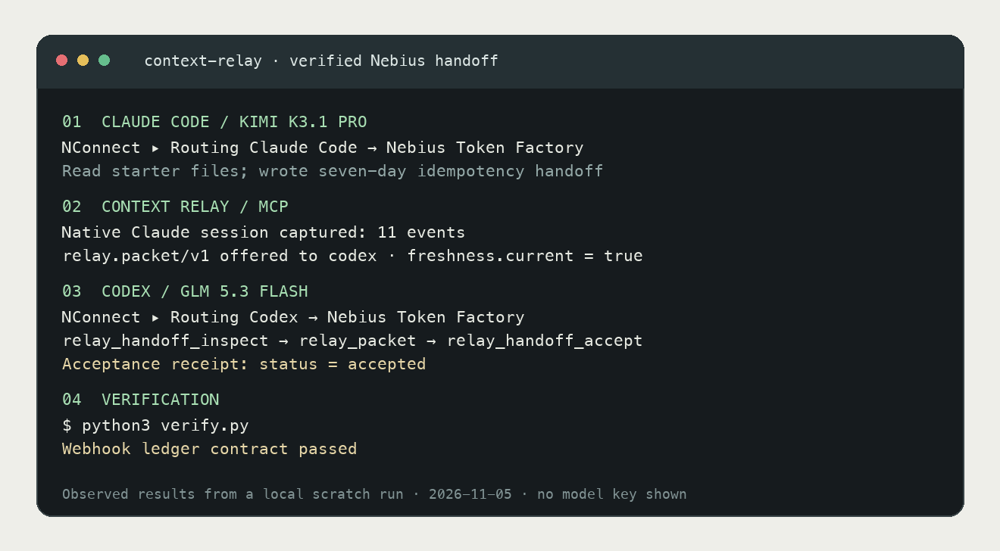
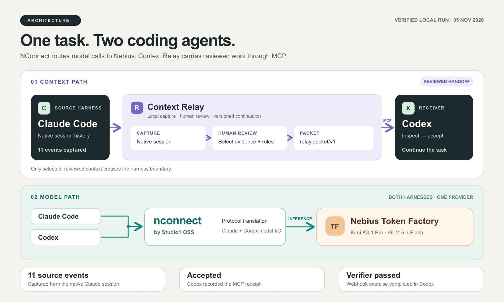
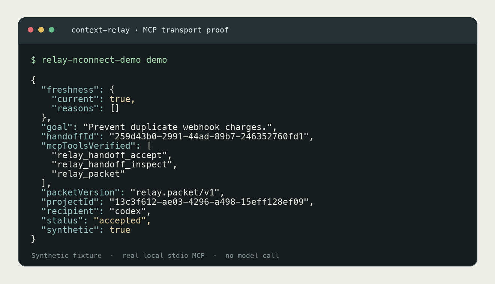

# Cross-harness handoffs with Context Relay, NConnect, and Nebius

Carry a reviewed coding task from Claude Code into Codex. [NConnect](https://nconnect.sh/) routes each agent's model calls to **Nebius Token Factory**; [Context Relay](https://github.com/mahekara28/context-relay) captures source history and serves the handoff through a project-scoped **MCP** server. The two tools have separate jobs: NConnect supplies the model, while Relay supplies the context.



## What this example shows

- A runnable, key-free check that creates a disposable **synthetic** Relay handoff, opens Relay's actual stdio MCP server, inspects its `relay.packet/v1` packet, and acknowledges it through `relay_handoff_accept`.
- A read-only `inspect` command for a real offered handoff. It checks the project, recipient, packet version and packet identity without accepting the handoff.
- A `check` command that launches Codex through NConnect and confirms the project-scoped `context_relay` MCP entry is enabled. It lists tools without requesting a model completion.
- A guided live path: use NConnect with a Nebius model for Claude Code, capture and review the session in Relay, then open Codex through NConnect with Relay's MCP entry available.

The offline check proves MCP transport and the handoff contract. It does **not** make a model call. A separate [live run](#verified-live-run) below captures a Claude Code session and completes the exercise in Codex through Nebius.

## Architecture



[Editable SVG source](assets/workflow.svg). The purple path carries selected context; the green path carries model requests through [NConnect by Studio1 OSS](https://github.com/Studio1-OSS/nconnect) to Nebius Token Factory.

No chat database is edited or silently merged. Relay captures completed visible turns, and the person making the handoff selects the evidence and instructions that the next agent may receive. The receiver still checks the working tree and does the remaining work.

## Tech stack

| Component | Role |
| --- | --- |
| [Context Relay `0.3.0-beta.1`](https://www.npmjs.com/package/@mahekara28/context-relay) | Local session capture, checkpoint review, handoff packet, stdio MCP server |
| [NConnect by Studio1 OSS](https://github.com/Studio1-OSS/nconnect) | Routes Claude Code and Codex model requests to Nebius Token Factory |
| [Nebius Token Factory](https://tokenfactory.nebius.com/) | Model inference; the verified run used `moonshotai/Kimi-K3.1-Pro` for Claude Code and `zai-org/GLM-5.3-Flash` for Codex |
| [MCP Python SDK](https://github.com/modelcontextprotocol/python-sdk) | Independent client used to verify Relay's MCP tools |

## Quick start: real MCP, synthetic data

Prerequisites: **Node.js 22.16+**, **Python 3.10+**, and the published Context Relay beta. No Nebius key, Claude Code or Codex install is needed for this check.

```sh
npm install --global @mahekara28/context-relay@0.3.0-beta.1
cd mcp_ai_agents/context_relay_nconnect_handoff
python3 -m venv .venv
. .venv/bin/activate
python -m pip install .
relay-nconnect-demo demo
```

The output contains `status: accepted`, `synthetic: true`, `packetVersion: relay.packet/v1` and the three verified MCP tools. `demo` uses a temporary Relay data directory and removes it when the command exits. To inspect the fixture afterward, pass `--data-dir /your/private/path`.

```sh
relay-nconnect-demo demo --data-dir /tmp/relay-handoff-example
python -m unittest discover -s tests -v
```

The test suite calls the published `relay` executable and its stdio MCP server. It checks both acceptance of the disposable fixture and that a read-only probe leaves an offered handoff untouched.



## Live path: Claude Code to Codex on Nebius

This path needs both agent CLIs installed and a **fresh** Nebius Token Factory API key. Keep the key in `nconnect configure` or an environment variable; never paste it into a prompt, README or Git commit. See [`.env.example`](.env.example) for the variable name. The Python demo does not read the key.

Install NConnect using its [official instructions](https://nconnect.sh/docs), then configure it:

```sh
nconnect configure
nconnect models
```

For a reproducible coding task, copy the [webhook idempotency exercise](sample_task/README.md) into a separate scratch project and follow its prompt. Its `verify.py` intentionally fails until the second agent finishes the rules:

```sh
cp -R sample_task /tmp/relay-webhook-lab
cd /tmp/relay-webhook-lab
```

From the **coding project to be handed off**, register the same root for both harnesses. Save the `projectId` from `project add` as `RELAY_PROJECT_ID`:

```sh
relay project add --root "$PWD"
relay connect --project "$RELAY_PROJECT_ID" --harness claude --capture-only
relay connect --project "$RELAY_PROJECT_ID" --harness codex
nconnect --model zai-org/GLM-5.3-Flash codex mcp list
relay-nconnect-demo check
```

Both checks should report `context_relay` as enabled; the second returns a small JSON result. Codex only loads project `.codex/config.toml` for a **trusted project**; if the entry is missing, [trust this project in Codex](https://learn.chatgpt.com/docs/config-file/config-basic) and repeat the check. The Claude connection captures native history without modifying its MCP settings. Review Codex's generated project config before committing your coding project. Put `--model` **before** the harness name; NConnect passes later options to the harness.

Start a genuine task in Claude Code and leave a specific unfinished step:

```sh
nconnect --model moonshotai/Kimi-K3.1-Pro claude
```

Relay's capture path is separate from MCP registration. After stopping the source session, find its connection ID, discover project sessions and capture them:

```sh
relay connections --project "$RELAY_PROJECT_ID"
relay discover --id CLAUDE_CONNECTION_ID
relay sync --id CLAUDE_CONNECTION_ID
relay ui
```

In Relay's local UI, review the captured source events, write a checkpoint with a goal, grounded instructions, acceptance criteria and open work, then **offer** that checkpoint to Codex. Copy the resulting `handoffId`. You can inspect that offered packet without changing its state:

```sh
relay-nconnect-demo inspect --project-id "$RELAY_PROJECT_ID" --handoff-id "$HANDOFF_ID"
```

Open a fresh Codex session in the same trusted project through NConnect. For the scratch exercise, this noninteractive command lets Codex's approval review handle the state-changing MCP acceptance and write only inside the workspace:

```sh
nconnect --model zai-org/GLM-5.3-Flash codex exec \
  --approve-for-me --skip-git-repo-check \
  "Inspect Context Relay handoff $HANDOFF_ID with relay_handoff_inspect and relay_packet. Verify freshness, accept it with relay_handoff_accept, implement the open work in webhook_ledger.py, and run python3 verify.py."
```

`--skip-git-repo-check` is for this scratch folder, which is not a Git repository. Headless Codex `exec` without an approval path denied `relay_handoff_accept` in our run; `--approve-for-me` allowed its automatic review to approve that local MCP call. Use `nconnect usage` to inspect model usage. A Relay acceptance receipt means the packet was delivered to the named recipient and passed freshness checks; verify the code and tests separately.

## Verified live run

On 2026-11-05, we ran this exercise in a separate local profile with Context Relay `0.3.0-beta.1`, NConnect `0.26.1`, Claude Code `2.1.318` and Codex. NConnect sent both agents' model calls to **Nebius Token Factory**; no provider key or transcript was committed.

```text
Claude Code / Kimi K3.1 Pro     Read the starter and wrote the idempotency handoff.
Context Relay                  Discovered and captured the native Claude session (11 events).
Context Relay                  Offered a sourced relay.packet/v1 packet to Codex.
Codex / GLM 5.3 Flash           Called relay_handoff_inspect and relay_packet; freshness.current = true.
Codex / GLM 5.3 Flash           Called relay_handoff_accept; status = accepted.
Codex / GLM 5.3 Flash           Implemented the open work in the scratch copy.
python3 verify.py               Webhook ledger contract passed.
```

The first receiver attempt exposed a missing assertion: a duplicate after an unrelated event must return the **original** result, not the current total. The exercise verifier now checks that case. The successful receiver run passed it and produced the acceptance receipt. This is a local in-memory exercise, not a production payment integration.

### Version boundary

This guide uses the **published** Context Relay `0.3.0-beta.1`. Its UI supports source review and handoff. A newer graph-style thread map exists in the Context Relay development tree but has **not** been published to npm, so this example does not require or claim that interface.

## Project structure

```text
context_relay_nconnect_handoff/
├── assets/workflow.svg             # editable architecture illustration
├── assets/workflow.png             # README and PR preview
├── assets/live-proof.png            # rendered summary of the verified live run
├── assets/mcp-proof.png             # rendered output of a real local MCP check
├── context_relay_nconnect_handoff/
│   └── cli.py                       # demo, read-only inspector, NConnect check
├── sample_task/                   # deliberately unfinished webhook exercise
├── tests/test_handoff.py            # integration checks against Relay's MCP server
├── .env.example                     # key name, no credential
├── pyproject.toml
└── README.md
```

## Safety and limits

The model receives whatever content you choose to send in the agent chat. Relay's built-in credential redaction is best effort; review selected evidence before offering it. The example does not upload transcripts on its own, alter native chat stores, or restore hidden model state. The verified run establishes this one local handoff and task result; it does not certify other harness versions, tasks or production use.

## Contributing and license

See the collection's [contribution guide](../../CONTRIBUTING.md) and [MIT license](../../LICENSE).
