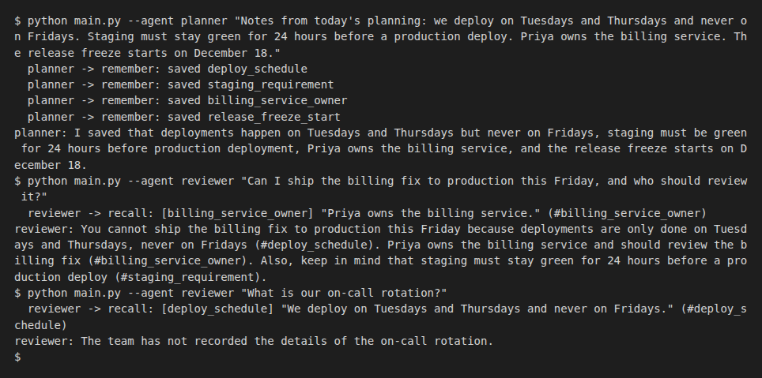
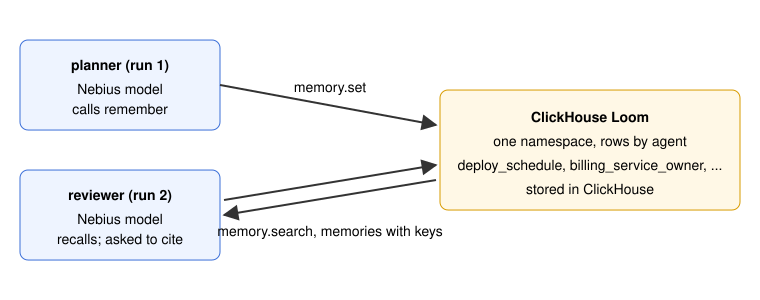

The capture uses `gpt-4.1-mini` through an alternative OpenAI-compatible endpoint, against Loom 1.2.0. The capture predates the recall confidence filter, which is covered by offline tests. The Nebius Token Factory default below has not been tested end to end.

# Shared Memory Agents with ClickHouse Loom

> Two agents that never talk to each other share what they learn: one saves facts, the other answers from them in a later run.

A `planner` agent takes notes from the user and saves each durable fact as a memory. A `reviewer` agent, started later in a separate process with no chat history, searches those memories before it answers and cites the key of each memory it used. Both agents keep their memory in [ClickHouse Loom](https://github.com/ClickHouse/loom), an open-source (Apache-2.0), self-hosted memory server for agents, through its Python SDK. A tool-calling model decides when to save and when to search. A reviewer answer is rejected if no recall has completed successfully.

## 🚀 Features

- **Memory shared between agents**: both agents read and write one Loom namespace, and Loom records each memory under the agent that wrote it.
- **Two small tools**: `remember` saves one fact with `memory.set`, and `recall` searches by meaning with `memory.search`, across every agent in the namespace.
- **Write outcomes**: the tool reports when Loom merges a fact, finds a duplicate or skips a write. It does not invent a surviving key for a no-op response.
- **Retrieval confidence**: an abstaining search supplies no memories to the model, and below-threshold hits are excluded from results and citation keys.
- **Checked citations**: the reviewer cites memory keys, and a key that no search returned is flagged in the answer instead of being passed on as a source.
- **Memory on your machine**: Loom runs locally in Docker, needs no account, and stores the memories in ClickHouse.

## 🛠️ Tech Stack

- **Python**: core language (3.11 or newer, the Loom SDK's minimum)
- **[ClickHouse Loom](https://github.com/ClickHouse/loom)**: memory server, used through the [`clickhouse-loom`](https://pypi.org/project/clickhouse-loom/) SDK
- **[Nebius Token Factory](https://dub.sh/nebius)**: the default model endpoint, through its OpenAI-compatible API and the `openai` client; other tool-calling endpoints can be configured
- **ClickHouse**: where Loom stores the memories

## Workflow



1. You tell the planner something. The model calls `remember` once per fact, and each call writes one memory to Loom.
2. The planner process exits. The reviewer starts in a new process with no planner chat history.
3. You ask the reviewer a question. The model calls `recall`, Loom returns the closest memories with their keys, and the model answers from them.
4. Before the answer is printed, every cited key is checked against the keys the searches returned.

## 📦 Getting Started

### Prerequisites

- Python 3.11 or newer
- Docker with the Compose plugin, for Loom
- An API key for [Nebius Token Factory](https://dub.sh/nebius) or another OpenAI-compatible endpoint with tool calling

### Start Loom

The release's installer downloads the stack, starts Loom and ClickHouse in Docker, and waits until Loom answers on `http://localhost:7777`. Run it from your home directory:

```bash
curl -fsSL https://github.com/ClickHouse/loom/releases/download/v1.2.0/install.sh -o loom-install.sh && sh loom-install.sh && rm loom-install.sh
```

This is a single-user install: it listens on localhost only and needs no token. The [Loom quickstart](https://github.com/ClickHouse/loom/blob/v1.2.0/docs/getting-started/quickstart.md) covers other options. To stop it later, run the `Stop:` command the installer prints.

### Environment Variables

Copy `.env.example` to `.env` and add your key:

```env
NEBIUS_API_KEY="your_nebius_token_factory_api_key"
NEBIUS_MODEL="Qwen/Qwen3-30B-A3B-Instruct-2507"
LOOM_BASE_URL="http://localhost:7777"
```

For another OpenAI-compatible endpoint with tool calling, put that provider's key in `NEBIUS_API_KEY`, and set `NEBIUS_BASE_URL` and `NEBIUS_MODEL` to its URL and model. The variable names stay the same for either provider. The recorded run used this configuration route; the default Nebius endpoint and model are unverified. For a team Loom server, set `LOOM_BASE_URL`, `LOOM_ORG`, `LOOM_NAMESPACE` and a `LOOM_API_KEY` from its dashboard.

### Installation

1. **Clone the repository:**

   ```bash
   git clone https://github.com/Arindam200/awesome-ai-apps.git
   cd awesome-ai-apps/memory_agents/loom_shared_memory_agents
   ```

2. **Install dependencies:**

   - **Using `uv` (recommended):**
     ```bash
     uv sync
     ```
   - **Using `pip`:**
     ```bash
     python -m venv .venv
     source .venv/bin/activate  # On Windows: .venv\Scripts\activate
     pip install .
     ```

## ⚙️ Usage

1. **Tell the planner about the project:**

   ```bash
   uv run main.py --agent planner "Notes from today's planning: we deploy on Tuesdays and Thursdays and never on Fridays. Staging must stay green for 24 hours before a production deploy. Priya owns the billing service. The release freeze starts on December 18."
   ```

   With pip, run `python main.py` instead of `uv run main.py`. The planner prints one line per saved fact, for example:

   ```text
     planner -> remember: saved deploy_schedule
     planner -> remember: saved staging_requirement
     planner -> remember: saved billing_service_owner
     planner -> remember: saved release_freeze_start
   ```

2. **Ask the reviewer, in a new run:**

   ```bash
   uv run main.py --agent reviewer "Can I ship the billing fix to production this Friday, and who should review it?"
   ```

   The reviewer searches the memory and answers with the keys it used, for example (the tool line shows the first result of each search):

   ```text
     reviewer -> recall: [billing_service_owner] "Priya owns the billing service." (#billing_service_owner)
   reviewer: You cannot ship the billing fix to production this Friday because deployments
   are only done on Tuesdays and Thursdays, never on Fridays (#deploy_schedule). Priya owns
   the billing service and should review the billing fix (#billing_service_owner). Also, keep
   in mind that staging must stay green for 24 hours before a production deploy
   (#staging_requirement).
   ```

   A question the memory cannot answer gets a plain "not recorded" reply. The exact wording and keys depend on the model.

3. **Look at the memories** in Loom's dashboard at `http://localhost:7777`: each one shows the agent that wrote it.

4. **Run the offline tests**, which stub the model and Loom:

   ```bash
   uv run python -m unittest discover -s tests
   ```

   With pip, activate the virtual environment from the installation step and run `python -m unittest discover -s tests`.

Loom is also an MCP server: an agent framework or coding agent with an MCP client can use the same memories over MCP instead of the SDK ([Loom's MCP client setup](https://clickhouse.github.io/loom/features/integrations/mcp-clients/)).

## 📂 Project Structure

```
loom_shared_memory_agents/
├── assets/
│   ├── demo.png          # A terminal capture of a run of both agents
│   └── workflow.svg      # How the two agents share memory
├── tests/
│   └── test_main.py      # Offline tests
├── .env.example          # Environment variables
├── main.py               # Both agents, their tools and the tool-calling loop
├── pyproject.toml        # Dependencies
└── README.md
```

## 🤝 Contributing

Contributions are welcome! Please feel free to submit a Pull Request. See the [CONTRIBUTING.md](https://github.com/Arindam200/awesome-ai-apps/blob/main/CONTRIBUTING.md) for more details.

## 📄 License

This project is licensed under the MIT License - see the [LICENSE](https://github.com/Arindam200/awesome-ai-apps/blob/main/LICENSE) file for details.

## 🙏 Acknowledgments

- [ClickHouse Loom](https://github.com/ClickHouse/loom) for the memory server and SDK.
- [Nebius Token Factory](https://dub.sh/nebius) for the default model API configuration.
