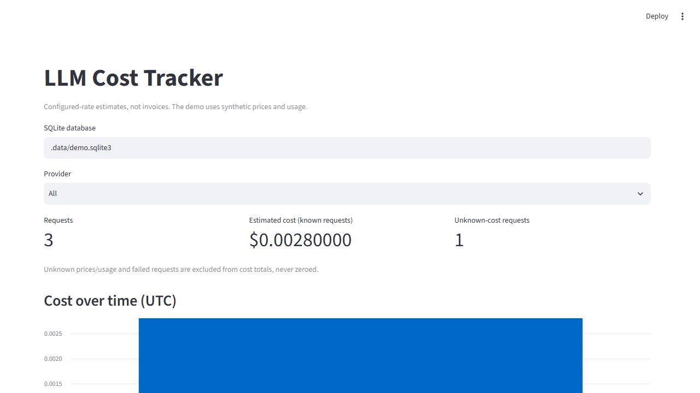

# LLM Cost Tracker

> Inspect per-request token usage, latency and configured-rate cost estimates across compatible providers.

A synchronous Python wrapper around `client.chat.completions.create`, a local SQLite
metadata store and a Streamlit dashboard. Built for maintainer-requested [issue #364](https://github.com/Arindam200/awesome-ai-apps/issues/364).



The screenshot uses three offline HTTP fixtures and synthetic prices. It is not evidence
of live provider billing or inference quality.

## Features

- Records requested model, caller-supplied provider label/tag, UTC timestamp, latency,
  usage counts, success/error status and estimated USD cost.
- Pricing is explicitly configured per provider and model, using decimal rates per million
  input/output tokens. The rate snapshot is loaded when the tracker is constructed.
- Missing/invalid usage, unknown prices and failed calls have **unknown** cost, not zero.
- The dashboard shows cost over time, by provider/model, and by tag, with a provider filter
  and a metadata table. Unknown-cost requests are counted separately and excluded from totals.
- Preserves the SDK's response and exception objects. A failed metadata write logs a generic
  warning and does not replace the result of the provider call.
- No prompt, response content, credential or provider error body is stored. Use non-secret tags.

## Tech Stack

Python 3.11+, the OpenAI Python client for compatible Chat Completions endpoints,
SQLite from the standard library, pandas, Streamlit, pytest and Ruff.
Python 3.11 is required for the standard-library `datetime.UTC` constant.

## Workflow

`tracker.create(...)` → existing client's non-streaming request → SDK usage metadata →
configured-rate calculation → parameterized SQLite insert → local dashboard.

The wrapper does not change the endpoint, authentication or retry configuration of an
existing client. Measured latency includes the SDK's retries. Failed requests have no
available response usage; unknown cost does not mean the provider charged nothing.

## Getting Started

### Prerequisites and Installation

- Python 3.11+ and [uv](https://docs.astral.sh/uv/)
- Live mode only: a compatible provider URL, API key and model ID. Nebius Token Factory
  is one supported configuration; no hosted account is required for the offline demo.

```bash
git clone https://github.com/Arindam200/awesome-ai-apps.git
cd awesome-ai-apps/simple_ai_agents/llm_cost_tracker
uv sync --python 3.12
```

### Environment Variables

For live mode, copy `.env.example` to `.env` in this directory, then configure the values
below. Create a live pricing file before sending requests:

```bash
cp .env.example .env
cp pricing.example.json pricing.json
```

Replace the copied synthetic `demo` entries with your provider's current model rates,
following the format below. `LLM_PRICING_FILE` defaults to `pricing.json`:

```dotenv
LLM_API_KEY=your_key
LLM_BASE_URL=https://api.tokenfactory.nebius.com/v1/
LLM_PROVIDER=nebius
LLM_MODEL=your_available_model
LLM_COST_DB=.data/usage.sqlite3
LLM_PRICING_FILE=pricing.json
```

The environment takes precedence over `.env`. Keep secrets local. The database and `.env`
are ignored by Git, and Streamlit usage telemetry is disabled in `.streamlit/config.toml`.

Use your provider's current published rates, such as the
[Nebius pricing catalog](https://tokenfactory.nebius.com/prices). Keys must match the
provider label and **requested** model ID you pass to the tracker:

```json
{
  "nebius": {
    "your_available_model": {
      "input_per_million_usd": "0.10",
      "output_per_million_usd": "0.20"
    }
  }
}
```

These numbers illustrate the file format; they are not real quotes for a model. Finite,
non-negative JSON numbers or decimal strings are accepted. `pricing.example.json` contains
synthetic demo rates only, so real models remain unpriced until you configure their rates.
Correcting the pricing path affects new requests; existing unknown-cost rows stay unknown.
Live mode never falls back to the synthetic demo pricing file. If the live file is missing,
the CLI explains how to create it and exits before sending a request. A configured file
without a rate for the selected provider/model produces a warning; the request can proceed
with an unknown cost. No provider rates are bundled or fetched automatically.

CLI and operator-configured dashboard relative paths (pricing, databases and `--database`)
are resolved against this example's directory. Absolute paths are
preserved and `~` is expanded. `CostTracker` used directly in your own application keeps
normal `Path` behavior; pass paths appropriate to that application.

## Usage

### Offline Dashboard

Before configuring live credentials, run:

```bash
uv run python main.py --demo
uv run streamlit run dashboard.py
```

Open the local URL Streamlit prints. If `LLM_COST_DB` is unset, explicitly select **Offline
demo** in the source selector. If it is set, **Configured requests** reads that operator-configured
database; **Offline demo** remains available as a separate fixed selection. Viewers cannot enter
arbitrary filesystem paths. Each demo invocation appends three requests:
two with known synthetic costs and one with unknown usage. The default demo file is separate
from `LLM_COST_DB`; `--database PATH` deliberately overrides this separation.

You can also launch from `simple_ai_agents/` without changing where files are stored:

```bash
uv run --project llm_cost_tracker python llm_cost_tracker/main.py --demo
uv run --project llm_cost_tracker streamlit run llm_cost_tracker/dashboard.py
```

### Live Request

```bash
uv run python main.py --tag research --prompt "Explain deterministic agent tests."
uv run streamlit run dashboard.py
```

Live calls may incur provider charges. The dashboard reads `LLM_COST_DB` when configured;
otherwise select **Live requests** to inspect the default live database, `.data/usage.sqlite3`.
Only metadata is recorded; this example does not print or persist the generated answer.

### Wrap an Existing Client

```python
from pathlib import Path
from openai import OpenAI
from tracker import CostTracker

client = OpenAI()  # Or your existing OpenAI-compatible client/base_url.
tracker = CostTracker(client, Path(".data/usage.sqlite3"), "my-provider", Path("pricing.json"))
response = tracker.create(
    model="my-model",
    tag="agent-research",
    messages=[{"role": "user", "content": "Summarize this task."}],
)
# response is the original SDK response; tag is consumed locally, never sent to the provider.
client.close()
```

Replace the call to `client.chat.completions.create` with `tracker.create`; this is a wrapper
for that synchronous method, not a proxy for the client's entire API. Async, streaming,
Responses, audio/image billing and custom nonstandard usage schemas are not supported.
Streaming is rejected before making a request.

## Accuracy and Storage Limits

Costs are **estimates from your configured rates**, not invoices. The calculation treats
all prompt tokens at one input rate and completion tokens at one output rate. Cached-token
discounts, batch pricing, provider-specific tiers, taxes and additional modalities are not
modeled. Request model aliases must have their own price entry; the response model ID is
not used to silently change rates. Existing rows retain their original estimated cost if
you edit the pricing file later.

Decimal arithmetic is used for storage and totals; chart values are converted to floats.
Provider usage counts are never estimated from text. SQLite writes have a five-second busy
timeout; persistence failure is warned and the row can be missing. The dashboard loads the
local table into memory, so this is a small example, not a high-volume monitoring service.
No retention, encryption, currency conversion or migration framework is included.

## Development and Verification

```bash
uv sync --all-groups --python 3.12
uv run ruff check .
uv run ruff format --check .
uv run pytest -q
```

Tests use temporary SQLite databases, real SDK request serialization with mock HTTP
transports and a loopback HTTP fixture server, concurrent writes, and Streamlit AppTest
interactions. They check unknown versus zero costs, decimal rates, provider separation,
failed writes/calls, secret-free
metadata and dashboard filters. No live-provider billing or inference was tested.
Startup regressions also run the CLI from the project, its parent and an unrelated directory,
and verify dashboard paths, missing live prices, custom paths and unknown-price warnings.

## Project Structure

```text
llm_cost_tracker/
├── tracker.py             # Request wrapper, pricing, SQLite storage
├── main.py                # Live request and offline fixture demo
├── dashboard.py           # Local read-only metadata dashboard
├── pricing.example.json   # Synthetic rates
├── pricing.json           # Create locally with verified provider/model rates
├── tests/test_tracker.py  # Offline behavior and UI checks
├── tests/test_http_endpoint.py # Actual loopback HTTP/SDK checks
├── tests/test_startup.py  # CLI configuration and dashboard path regressions
├── tests/test_review_followup.py # Data source selection and startup error handling
├── assets/demo.png
├── .env.example
├── .streamlit/config.toml
├── pyproject.toml
└── README.md
```

## Contributing

Follow the repository [contribution guide](../../CONTRIBUTING.md). Add tests when extending
provider usage handling or billing rules, and keep synthetic fixtures explicitly labeled.

## License and Acknowledgments

MIT, matching the repository [license](../../LICENSE). Built with the OpenAI-compatible
client, Streamlit, pandas and SQLite for issue #364.
