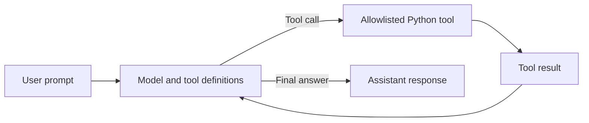

# Local LLM Starter

A lightweight tool-calling agent built with the OpenAI Python SDK and any OpenAI-compatible Chat Completions API. It runs locally with Ollama by default and can be pointed at another compatible hosted or self-hosted endpoint.

## Features

- **Provider-neutral configuration**: One set of environment variables works with any compatible endpoint.
- **Local by default**: Uses Ollama's OpenAI-compatible API; no paid API key is required when the local server does not require authentication.
- **Hosted or self-hosted**: Point the same code at another compatible service by changing the base URL, key, and model; the README includes a Nebius Token Factory example.
- **Three built-in tools**: Current time, word count, and safe arithmetic calculation.
- **Shared tool-calling loop**: The model requests a tool, Python runs it, and the result goes back to the model.
- **No agent framework**: The loop and tool schemas are small, explicit, and easy to follow.
- **Bounded execution**: The loop stops after five tool-call rounds.
- **Allowlisted tools**: Only the three functions in `main.py` can run.

## Tech Stack

- **Python 3.10+**
- **OpenAI Python SDK**: Chat Completions and tool calling
- **python-dotenv**: Loads settings from `.env`
- **Ollama**: Default local inference backend
- **Any OpenAI-compatible endpoint**: Optional hosted or self-hosted backend
- **Ruff**: Optional formatting and linting

## Workflow

1. The user enters a prompt.
2. The model receives the prompt and the available tool definitions.
3. The model requests a tool when needed.
4. Python executes the requested allowlisted tool.
5. The tool result is returned to the model.
6. The model generates the final answer.



Each prompt starts a fresh conversation; chat history is not persisted between prompts.

## Prerequisites

- Python 3.10 or newer
- [uv](https://github.com/astral-sh/uv) (recommended) or pip
- An OpenAI-compatible Chat Completions endpoint
- A model and server combination that supports tool calling

Local inference does not require a paid API key when the local backend does not require authentication. Hosted endpoints may require a key and may charge for usage.

## Compatibility

This project uses the OpenAI-compatible Chat Completions API. It can work with services such as:

- [Ollama](https://ollama.com/)
- [LM Studio](https://lmstudio.ai/)
- [vLLM](https://docs.vllm.ai/)
- [OpenAI](https://platform.openai.com/)
- [Nebius Token Factory](https://tokenfactory.nebius.com/)
- Other services that expose an OpenAI-compatible Chat Completions interface

These are examples, not a guarantee of universal compatibility.

Compatibility has two separate parts:

- **Endpoint compatibility**: The service must expose Chat Completions and accept tool definitions.
- **Model compatibility**: The selected model must support tool calling and follow the tool schemas reliably.

A compatible endpoint can still run a model that does not support tools. Native APIs that do not expose the expected OpenAI-compatible interface are not supported by this implementation without adaptation.

## Installation

Clone the repository and enter the project directory:

```bash
git clone https://github.com/Arindam200/awesome-ai-apps.git
cd awesome-ai-apps/starter_ai_agents/local_llm_starter
```

Using `uv` (recommended):

```bash
uv sync
cp .env.example .env
```

`uv sync` also installs the development tools. Use `uv sync --no-dev` if you only want the runtime dependencies.

Using pip:

```bash
python -m venv .venv
source .venv/bin/activate  # On Windows: .venv\Scripts\activate
pip install openai python-dotenv
cp .env.example .env
```

## Configuration

The agent reads three environment variables:

| Variable | Purpose | Default |
| --- | --- | --- |
| `LLM_BASE_URL` | Base URL of the OpenAI-compatible API | `http://localhost:11434/v1` |
| `LLM_API_KEY` | API key for the endpoint | `not-needed` |
| `LLM_MODEL` | Model identifier | `qwen3:8b` |

The default `.env.example` is ready for local Ollama:

```env
LLM_BASE_URL=http://localhost:11434/v1
LLM_API_KEY=not-needed
LLM_MODEL=qwen3:8b
```

To use LM Studio, start its local server and set the model ID shown in LM Studio:

```env
LLM_BASE_URL=http://localhost:1234/v1
LLM_API_KEY=not-needed
LLM_MODEL=<model-id-from-lm-studio>
```

To use a hosted compatible endpoint, replace the values with the endpoint, key, and model identifier provided by that service:

```env
LLM_BASE_URL=https://your-endpoint.example.com/v1
LLM_API_KEY=your_api_key
LLM_MODEL=your-model-id
```

### Hosted example: Nebius Token Factory

Nebius Token Factory is an optional hosted OpenAI-compatible backend. Hosted usage may require an account and may be billed. Replace the placeholder key and model with the values from your account:

```env
LLM_BASE_URL=https://api.tokenfactory.nebius.com/v1/
LLM_API_KEY=your_nebius_api_key
LLM_MODEL=Qwen/Qwen3-30B-A3B
```

Switching between local Ollama and a hosted endpoint only requires changing these three values; no code changes are needed.

Do not commit `.env` or real credentials.

## Usage

With `uv`:

```bash
uv run python main.py
```

Or activate the environment and run it directly:

```bash
python main.py
```

Before running, make sure the model named by `LLM_MODEL` is available in your server. With the default configuration, pull it first:

```bash
ollama pull qwen3:8b
```

If you already have another tool-capable model, set `LLM_MODEL` to its exact identifier instead. You can list Ollama models with `ollama list`.

At startup, the terminal shows the endpoint and model. Then enter a prompt:

```text
Endpoint: http://localhost:11434/v1
Model: qwen3:8b
Type 'exit' or 'quit' to stop.

You: What time is it right now?

Assistant: The current local time is 2026-11-01 12:50:05 IST.
```

Try each tool:

- **Current time:** `What time is it right now?`
- **Word count:** `How many words are in this sentence: local models are fun to run?`
- **Calculator:** `What is (18 + 6) * 3 / 4?`

You can also combine tools in one request:

```text
What time is it, and how many words are in "small local models are useful"?
```

Type `exit` or `quit` to stop, or press `Ctrl+C`.

## Hardware Requirements

Hardware requirements depend on the selected model, quantization, context length, and serving backend. There is no single requirement that applies to every setup.

- Local inference needs enough memory for the model, its context window, and runtime overhead.
- CPU-only inference works but is usually slower than GPU inference.
- Hosted endpoints run the model on the provider's hardware, so your machine only needs to run this Python client.

Check the model and serving backend documentation for their actual requirements.

## Model Suggestions

The default `qwen3:8b` is a tool-capable model that works with Ollama. A smaller model such as `qwen3:4b` can be a better starting point on a lower-memory laptop. Both are examples, not guarantees; tool support varies by model and serving backend.

Check the capabilities before relying on a model:

```bash
ollama show qwen3:8b
```

Look for `tools` in the output. If the model does not list `tools`, choose another tool-capable model. A 4B–9B quantized model is a reasonable starting range for laptop inference, but actual memory use depends on quantization, context length, and the serving backend.

## Limitations

This starter is intentionally small. It is a single-user command-line example, not a production service.

- **Compatibility is not universal.** The endpoint must expose OpenAI-compatible Chat Completions with tool support, and the model must support tool calling. The services listed in this README are examples, not guarantees.
- **Only Chat Completions is used.** Native provider APIs, the OpenAI Responses API, streaming, vision, embeddings, and other endpoint types are not implemented.
- **No conversation history.** Each prompt starts a new conversation. The starter does not persist or resume chat history.
- **No streaming.** The client waits for a complete response before printing the answer.
- **No retries or backoff.** API errors and rate limits are surfaced to the user; the starter does not retry automatically.
- **No fallback endpoint.** The starter uses the single configured endpoint and does not switch to another provider or model automatically.
- **One API key only.** Authentication is a single `LLM_API_KEY` value. Custom headers, OAuth, proxies, and provider-specific auth flows are not included.
- **No server management.** The starter does not install, start, or download models. You must run the compatible server and pull or load the model yourself.
- **Tool calls are limited.** The loop stops after five rounds. Tool arguments must be JSON objects with the exact string arguments defined in `main.py`; complex or nested argument types are not supported.
- **Calculator limits.** Expressions are limited to 200 characters; exponents above 20, integer results above 4096 bits, and non-finite float results are rejected.
- **Empty responses are surfaced as text.** If the model returns no final content, the starter prints `The model returned an empty response.` instead of guessing an answer.
- **No observability.** Tool errors and final answers are printed to the terminal. Logging, tracing, metrics, and evaluation are not included.

## Troubleshooting

### Connection refused or unreachable endpoint

- Confirm the server is running.
- Check `LLM_BASE_URL` and the port.
- For Ollama, confirm the service responds:

  ```bash
  curl http://localhost:11434/api/tags
  ```

- For another compatible server, confirm its `/v1/models` endpoint responds.

The first request can take longer while the backend loads the model into memory.

### Incorrect model identifier

List the models available from the server and use the exact identifier:

```bash
ollama list
```

For other backends, use their model list or `/v1/models` endpoint. Model tags matter: `qwen3:8b` is not the same identifier as `qwen3:latest`.

### Missing or incorrect API key

Set `LLM_API_KEY` in `.env`. Many local servers ignore the key, but the OpenAI SDK requires a non-empty value, so `not-needed` is a safe placeholder. Hosted endpoints usually require a real key.

### Model does not support tool calling

Tool calling is a model capability. Some models can chat but do not support tools. Check the model's documentation or capabilities:

```bash
ollama show qwen3:8b
```

Look for `tools` in the output. If the model does not support tools, choose a tool-capable model instead of expecting the agent to invent a result.

### Tool-call compatibility differs between backends

Serving backends expose the same broad API but can differ in tool-calling details, response shapes, and supported parameters. This starter sends only the `tools` field and does not send `tool_choice`, which keeps it compatible with a wider range of servers. Some models may still call tools unreliably or return malformed arguments. If that happens, try another tool-capable model or check the backend's documentation.

### The assistant seems to answer without using a tool

The terminal prints only the final answer, not the tool call. For example, `what is 3+5` can call `calculate`, receive `8`, and then print `3 + 5 = 8`. That looks like a direct answer even though the tool ran.

Each prompt also starts a fresh conversation. A follow-up such as `did you use a tool?` cannot see the previous prompt's tool call, so the model may correctly say no. To verify tool usage, use a single prompt that requires a tool and check that the answer reflects the tool result, or add temporary logging in `run_agent` around `run_tool`.

### The calculator rejects an expression

The calculator accepts numbers, parentheses, and `+`, `-`, `*`, `/`, `//`, `%`, and `**`. It rejects names, function calls, imports, and other Python syntax. Expressions are limited to 200 characters, exponents above 20 are rejected, integer results above 4096 bits are rejected, and non-finite float results are rejected.

### The model returned an empty response

A thinking model can occasionally finish a tool-calling turn without producing final text. The starter prints `The model returned an empty response.` in that case. Retry the prompt; if it happens repeatedly, try a different tool-capable model or adjust the model's thinking mode if the backend supports it.

### Tool errors

When a tool fails, the error is sent back to the model so it can correct the request. The model may retry with different arguments. If it keeps failing, check the model's tool-calling support or simplify the prompt.

## Project Structure

```text
local_llm_starter/
├── main.py          # Configuration, tools, agent loop, and terminal UI
├── pyproject.toml   # Dependencies and Ruff configuration
├── .env.example     # Environment variable template
└── README.md
```

## Development Checks

Install the development dependency and run the checks:

```bash
uv sync
uv run ruff check .
uv run ruff format --check .
uv run python -m py_compile main.py
```

To apply formatting:

```bash
uv run ruff format .
```

## Contributing

Contributions are welcome. Please read the repository's [CONTRIBUTING.md](../../CONTRIBUTING.md), open an issue before starting a new project, and submit one project per pull request. See the [README template](../../.github/README_TEMPLATE.md) for the expected documentation structure.

## License

This project is licensed under the MIT License. See the repository's [LICENSE](../../LICENSE) for details.

## Acknowledgments

- [OpenAI Python SDK](https://github.com/openai/openai-python) for the client and tool-calling types
- [python-dotenv](https://github.com/theskumar/python-dotenv) for loading environment variables
- [Ollama](https://ollama.com/) for the default local OpenAI-compatible backend
